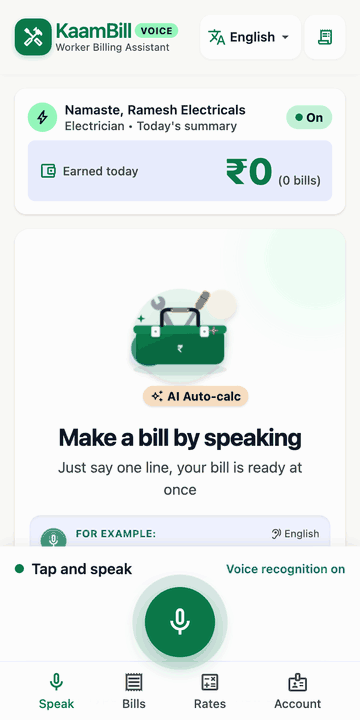

# KaamBill: Bol ke bill banaiye 🎙️₹

**Voice billing for Indian tradespeople.** An electrician says (or dictates) one sentence:

> _"Verma ji ke ghar 2 Havells MCB, 15 meter Finolex wire, aur 500 labour ka bill bana do"_

KaamBill builds the itemized bill (**₹1,235**), asks at most one question at a time, shows the total for a final "_haan_", takes the payment details, shows the UPI QR, and opens WhatsApp with the PDF bill. **The worker always presses Send.**

Built for **India Runs on Voice** (Scaler × Wispr Flow), Small business track. 🗣️ **Built hands-free with [Wispr Flow](https://wisprflow.ai)**: specs, prompts and code were dictated with Flow.

## Live demo

| What                 | URL                                                                                                 |
| -------------------- | --------------------------------------------------------------------------------------------------- |
| Landing page         | [kaambillapp.onrender.com](https://kaambillapp.onrender.com/)                                       |
| The app              | [kaambillapp.onrender.com/app/](https://kaambillapp.onrender.com/app/)                              |
| The app in demo mode | [kaambillapp.onrender.com/app/?demo=1](https://kaambillapp.onrender.com/app/?demo=1) (skips set-up) |
| Health check         | [kaambillapp.onrender.com/api/health](https://kaambillapp.onrender.com/api/health)                  |

Hosted on Render's free plan, which puts an idle service to sleep: the first visit after a quiet spell can take a while to load.

## See it working



A screen recording of the real app in demo mode, from job to bill. Also available in [हिंदी](app/public/kaambill-demo-hindi.gif) and [Hinglish](app/public/kaambill-demo-hinglish.gif).

---

## How it works

**Customer journey** (a step bar shows where the bill is):

| #   | Step               | What the worker does                                                                                                                                                      |
| --- | ------------------ | ------------------------------------------------------------------------------------------------------------------------------------------------------------------------- |
| 1   | **Saaman** (items) | Taps the mic and speaks, or taps **"Likh ke daalein"** to type / dictate with Wispr Flow                                                                                  |
| 2   | **Jaanch** (check) | Answers one question at a time (a missing price, an unsure quantity), then confirms the total with "haan"                                                                 |
| 3   | **Details**        | Checks the amount and their UPI ID, adds the customer's WhatsApp number, picks UPI / Cash / Baad mein (later)                                                             |
| 4   | **Payment**        | The customer scans the QR (amount filled in) → the worker taps "Paisa mil gaya ✓" (or "Cash mila ✓"). KaamBill can't see payments, so "paid" is the worker's confirmation |
| 5   | **Bill**           | The bill/PDF says **PAID** or **DUE**; WhatsApp opens with it and the worker presses Send                                                                                 |

**Voice in, screen out:**

- **Mic button = KaamBill listens** (the phone browser's speech recognition, live transcript). Pauses are fine: the turn ends after **4 s** without new words or on **"Ruk jaiye"**.
- **Text box = typing or Wispr Flow.** Hidden until "Likh ke daalein" is tapped. A web page can't launch Wispr Flow itself (no API or link exists), so Flow is used from its own keyboard / shortcut inside the box.
- **No text-to-speech:** the app never speaks; questions and the read-back are on screen.

**App language:** Hinglish (default) · हिंदी · English, chosen in the top bar. It switches every screen text, the mic language and the app's messages together. Only these three languages are supported.

**Phone-only layout:** designed for 360–430 px screens; on a computer it shows as a phone-width column.

## What you need

|                                   | Needed?                       | Why                                                                                                                                                                                                                           |
| --------------------------------- | ----------------------------- | ----------------------------------------------------------------------------------------------------------------------------------------------------------------------------------------------------------------------------- |
| **Groq API key** (`GROQ_API_KEY`) | ✅ **Required, the only key** | The Groq LLM (`openai/gpt-oss-120b`, strict JSON) turns the spoken / typed words into the bill: customer, items, quantities, labour, intent. Without it the app can't build bills. Only the text is sent to Groq, never audio |
| Browser speech recognition        | Built in, no key              | The mic button (Chrome on Android / desktop)                                                                                                                                                                                  |
| Wispr Flow app                    | Optional, no key              | For dictating into the text box in any browser (sign in to the app). Pick **Wispr Flow (typing box)** on the landing page to open the box straight away                                                                       |
| Text-to-speech                    | ❌ Not used                   | The app never speaks                                                                                                                                                                                                          |
| Render account                    | For hosting                   | Runs the one Node service (`npm start`): landing page, app and `/api`                                                                                                                                                         |

## Quick start

```bash
npm install
cp .env.example .env       # then set GROQ_API_KEY (the only required variable)
npm run check:env          # validates the env and confirms the Groq key works (prints no secrets)
npm run dev                # landing page on http://localhost:5173, app on /app/ + local API on :3000 (real Groq)
```

Try it: open http://localhost:5173/app/?demo=1 → **Likh ke daalein** → type the sentence above → "Haan, sahi hai" → "Haan, bhejo" → UPI → "Paisa mil gaya ✓".

### Run it locally with an AI coding assistant

Not comfortable with the terminal? Paste this prompt into Cursor (or any coding assistant) to set up and run KaamBill on your computer:

```text
Set up and run the KaamBill app on my computer.

1. Clone https://github.com/asankhua/kaambillapp and open the folder (or use it if I already have it).
2. Run `npm install`.
3. Create `.env` by copying `.env.example`. Set `GROQ_API_KEY` to my Groq key (free key at https://console.groq.com). Do not print the key or commit it.
4. Run `npm run check:env` and fix anything it reports.
5. Run `npm run dev` and leave it running.
6. Tell me these links when it is up:
   - Landing page: http://localhost:5173/
   - Live app (demo, skips set-up): http://localhost:5173/app/?demo=1
```

### Deploy on Render

Create a **Web Service** from this repo (branch `main`, runtime Node) with:

| Setting           | Value                                                                                                                  |
| ----------------- | ---------------------------------------------------------------------------------------------------------------------- |
| Build Command     | `npm install && npm run build`                                                                                         |
| Start Command     | `npm start`                                                                                                            |
| Health Check Path | `/api/health`                                                                                                          |
| Environment       | `GROQ_API_KEY` (required). Do not set `NODE_ENV=production`, it would skip the dev dependencies that `npm start` needs |

`npm start` ([`phase-0-setup/scripts/serve.ts`](./phase-0-setup/scripts/serve.ts)) serves the landing page (`/`), the app (`/app/`) and the API (`/api/`) from one process on Render's `PORT`. The service's own URL is allowed as an origin automatically (`RENDER_EXTERNAL_URL`); add custom domains to `ALLOWED_ORIGINS`.

| Command                                                          | What it does                                                                                                                                                                                                                                                                                             |
| ---------------------------------------------------------------- | -------------------------------------------------------------------------------------------------------------------------------------------------------------------------------------------------------------------------------------------------------------------------------------------------------- |
| `npm run dev:web` / `npm run dev:api`                            | Only the app (Vite) / only the local API (serves `api/*.ts`, no hosting login)                                                                                                                                                                                                                           |
| `npm run build && npm start`                                     | The production server (what Render runs): landing page, app and API on `$PORT`                                                                                                                                                                                                                           |
| `npm run typecheck && npm run lint && npm test && npm run build` | Everything CI runs (typecheck = every folder's own tsconfig)                                                                                                                                                                                                                                             |
| `npm run test:phase -- 4`                                        | One phase's unit tests, then its e2e tests (`--unit` to skip e2e)                                                                                                                                                                                                                                        |
| `npm run e2e`                                                    | All end-to-end tests on a 360×800 phone viewport                                                                                                                                                                                                                                                         |
| `npm run ui:parity`                                              | Screenshot every screen next to its Stitch design → `phase-6-quality-demo/eval/results/ui-parity/`                                                                                                                                                                                                       |
| `npm run icons`                                                  | Rebuild the icon-font subset in `app/index.html` (only the icons the code uses, ~27 KB) and check each renders                                                                                                                                                                                           |
| `npm run eval:extract`                                           | 208-sentence eval (125 Hinglish · 43 Hindi · 40 English) on real Groq → `results/phase6.md` (all, by language) + `results/phase3.md` (30 seed). **Resumable**: each scored sentence is cached, so a re-run continues after the free-tier quota resets; `-- --report` rebuilds the reports from the cache |
| `npm run rehearsal:todo`                                         | To-do rehearsal (new-domain swap) on real Groq                                                                                                                                                                                                                                                           |
| `npm run domain:new -- <name>`                                   | Scaffold a new voice domain in `domain-<name>/`                                                                                                                                                                                                                                                          |
| `npm run warmup -- <url>`                                        | Before going on stage: health check + one real extraction                                                                                                                                                                                                                                                |

**Environment:** `.env` at the repo root (git-ignored) needs only `GROQ_API_KEY`; everything else has a default (see the commented template [`.env.example`](.env.example)). Never put a key in a `VITE_*` variable (those are bundled into the browser). On Render set `GROQ_API_KEY` under **Environment**; old `SARVAM_*`, `VOICE_PROVIDER` and `GROQ_STT_MODEL` lines in an existing `.env` are ignored.

## Read first

| Doc                                                                              | What it covers                                                                                                                                                              |
| -------------------------------------------------------------------------------- | --------------------------------------------------------------------------------------------------------------------------------------------------------------------------- |
| [`docs/problemStatement.md`](./docs/problemStatement.md)                         | Problem, users, market size, constraints, success metrics                                                                                                                   |
| [`docs/architecture.md`](./docs/architecture.md)                                 | System design: customer journey (§3.0), state machine, speech-to-text and Wispr Flow (§5.1), Groq extraction (§5.2), app language (§5.6), screens (§7), configuration (§13) |
| [`docs/implementationPlan.md`](./docs/implementationPlan.md)                     | Phases 0–8 with status, screen build map, accounts and keys                                                                                                                 |
| [`phase-1-ui-ux-design/stitchPrompt.md`](./phase-1-ui-ux-design/stitchPrompt.md) | Google Stitch prompts + fix prompts F1–F9                                                                                                                                   |
| [`phase-6-quality-demo/eval/results/`](./phase-6-quality-demo/eval/results/)     | Eval, UI parity and Lighthouse results                                                                                                                                      |

## The code is organised by phase

Each phase folder holds its **plan** (`README.md`) **and its code + tests**. `app/` wires the phases into one app; `api/` holds the one-line entry point of each endpoint. **A phase may import earlier phases, never later ones** (enforced by ESLint).

| Folder                                                 | Code                                                                                                                                                                               | Tests                                      |
| ------------------------------------------------------ | ---------------------------------------------------------------------------------------------------------------------------------------------------------------------------------- | ------------------------------------------ |
| [`phase-0-setup/`](./phase-0-setup/)                   | `@kaambill/shared` (types, Zod schema), seed rate card, server env + `/api/health`, local dev API, test helpers                                                                    | schema, env                                |
| [`phase-1-ui-ux-design/`](./phase-1-ui-ux-design/)     | Stitch export (`design/`), theme CSS generated from it, tokens, `Icon`, icon-font subset                                                                                           | icons · e2e                                |
| [`phase-2-voice-core/`](./phase-2-voice-core/)         | Conversation machine (read-back gate), Web Speech (4 s pauses, auto-restart), text box, app language (`useT`), shell (top bar, dock, 4-tab nav, banners)                           | machine, STT · e2e                         |
| [`phase-3-understanding/`](./phase-3-understanding/)   | Normalizer (Indian numbers, Devanagari 1–100), `/api/extract` client, Groq strict-schema extraction (`LlmProvider`), rate limit, prompt                                            | normalizer, client, API                    |
| [`phase-4-billing-domain/`](./phase-4-billing-domain/) | Matcher, rate card, bill model, clarifier, messages in 3 languages, billing adapter, journey step bar, S3–S6/S8 screens                                                            | domain, matcher · e2e                      |
| [`phase-5-output-share/`](./phase-5-output-share/)     | Payment details → payment → invoice (PAID/DUE), UPI link + QR, A6 PDF, share, history, drafts, profile, Home, S1/S7/S9 screens                                                     | output, PDF · e2e (incl. offline)          |
| [`phase-6-quality-demo/`](./phase-6-quality-demo/)     | Telemetry, 208-sentence eval + resumable runner + results, UI-parity capture, demo pack                                                                                            | telemetry, eval data                       |
| [`phase-7-domain-sprint/`](./phase-7-domain-sprint/)   | To-do rehearsal (schema, adapter, endpoint), new-domain scaffold + playbook                                                                                                        | rehearsal                                  |
| [`phase-8-finale/`](./phase-8-finale/)                 | Demo mode (`?demo=1`), finale scripts, pitch                                                                                                                                       | e2e (Wispr Flow box), landing translations |
| [`app/`](./app/)                                       | `index.html` (landing page at `/`), `landing/` (its CSS + script), `app/index.html` (the app at `/app/`), Vite/PWA config, `main.tsx`, `App.tsx` (wires all phases), static assets | e2e                                        |
| [`api/`](./api/)                                       | Entry files re-exporting each phase's endpoint (served by `npm start` and `npm run dev:api`)                                                                                       | —                                          |

### What stays at the repo root (and why)

| File                                            | Why it can't move                                                                                                                                                     |
| ----------------------------------------------- | --------------------------------------------------------------------------------------------------------------------------------------------------------------------- |
| `package.json`, `package-lock.json`             | npm installs and links the workspaces from the root. It holds the scripts and shared tooling; **each phase has its own `package.json`** with its runtime dependencies |
| `eslint.config.js`                              | ESLint and editors look for it at the root. It's a one-line re-export of `phase-0-setup/eslint.rules.js`                                                              |
| `README.md`                                     | Entry point; the project-wide docs live in [`docs/`](./docs/)                                                                                                         |
| `.env`, `.env.example`, `.gitignore`, `.husky/` | Read from the root by Vite, Node, git                                                                                                                                 |

TypeScript: `phase-0-setup/tsconfig.base.json` + a `tsconfig.json` (and `tsconfig.server.json`) **in every phase folder**, `app/` and `api/` (`npm run typecheck` checks them all, or `-- 4` for one phase). Tests: Vitest and Playwright configs in `phase-6-quality-demo/`.

## Stack

Groq (`openai/gpt-oss-120b`, strict JSON schema) · browser Web Speech (input only) · Wispr Flow (dictation into the text box) · XState · IndexedDB · `qrcode` + `jspdf` + Web Share API · Vite + React + Tailwind (theme from the Stitch export) · Vitest + Playwright.

## License

[MIT](./LICENSE), © 2026 Ashish Kumar Sankhua. The landing page footer links to the same file (`app/public/LICENSE.txt`) as a download.
