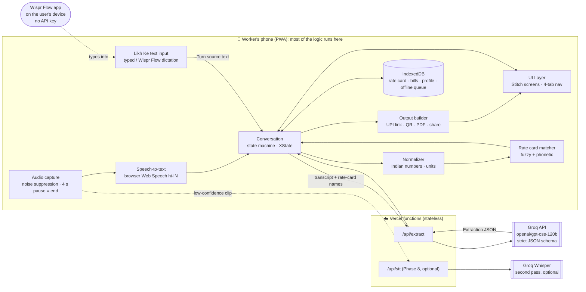
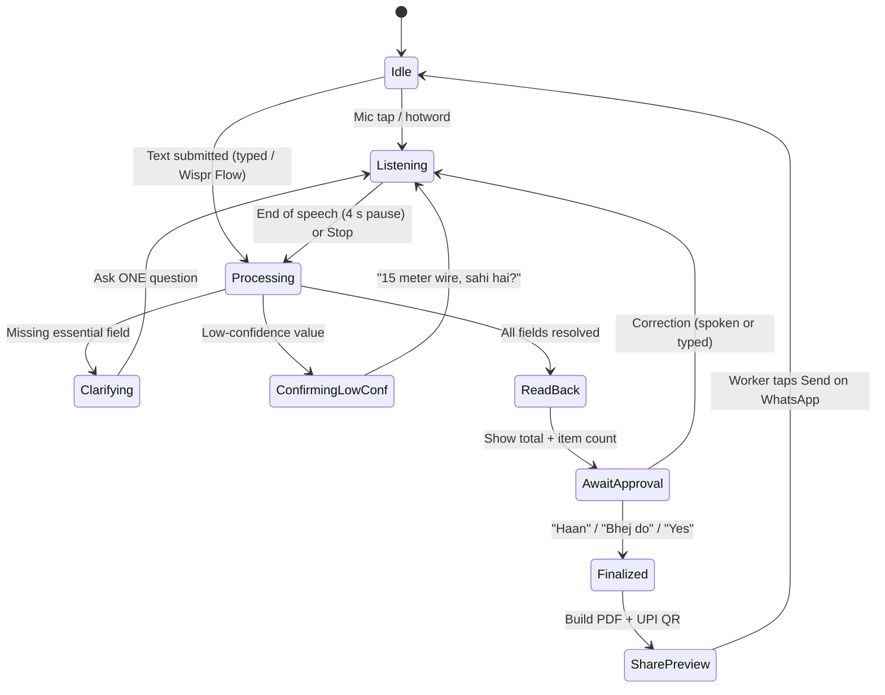
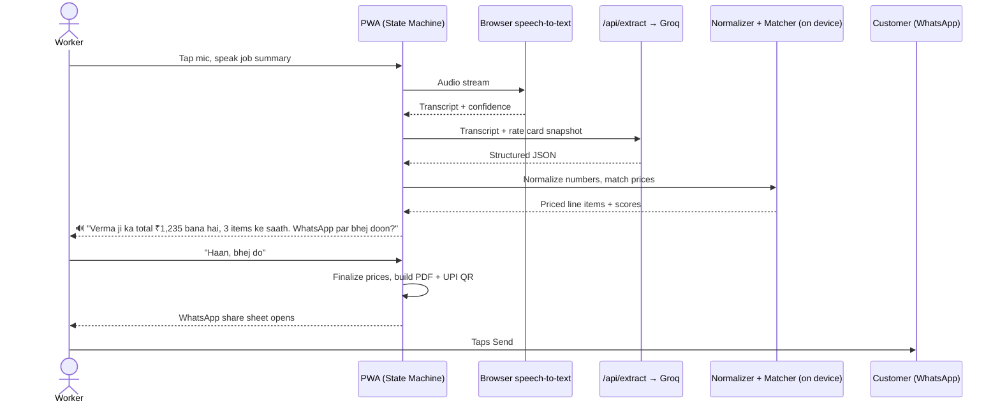

# Architecture — KaamBill

> Related documents in this folder:
>
> - [`problemStatement.md`](./problemStatement.md): the problem, users, constraints and success metrics this design must meet.
> - [`implementationPlan.md`](./implementationPlan.md): the phase-by-phase build plan (one folder per phase).
>
> This document describes **how** the system is built to satisfy the problem statement.
>
> **Current state (21 Nov, the 8:05 PM build; persona: electricians, plumbers, AC technicians).** A kirana-store variant was tried at 8:08 PM and fully reverted; this doc describes the tradesperson app.
>
> | Decision (21 Nov)                                                                                                                                                                                          | Where      |
> | ---------------------------------------------------------------------------------------------------------------------------------------------------------------------------------------------------------- | ---------- |
> | **Customer journey:** 1 Items → 2 Check (one question at a time + total for "haan") → 3 Payment details → 4 Payment (UPI QR / cash / later; "paid" = the worker's confirmation) → 5 Bill (PAID / DUE)      | §3.0       |
> | **Voice in, screen out:** speech-to-text required; **no text-to-speech**                                                                                                                                   | §5.1, §5.6 |
> | **Mic = KaamBill listens** (browser speech, 4 s pause allowed, auto-restart, "Ruk jaiye" to stop); **text box = typing / Wispr Flow**, hidden until "Likh ke daalein" (a web page can't launch Wispr Flow) | §5.1       |
> | **App language** Hinglish · हिंदी · English switches screen text, mic language and messages                                                                                                                 | §5.6       |
> | **Groq LLM key is the only required key** (`/api/extract` turns words into the bill)                                                                                                                       | §13.3      |
> | **UI** matches the Stitch export; 4-tab nav (Boliye · Bills · Rates · Khata); phone-only layout (phone-width column on big screens)                                                                        | §7, §8     |
> | **Eval:** 208 sentences (125 Hinglish · 43 Hindi · 40 English), resumable runner → `phase6.md` + `phase3.md`                                                                                               | §8         |
>
> **Hackathon context:** KaamBill is built for _India Runs on Voice_ (Scaler × Wispr Flow), where the product is voice-first **and** is itself built hands-free with **Wispr Flow** (see §12).
> Two different "voice" layers appear in this doc. Don't mix them up:
>
> - **Wispr Flow app (no API key):** how _we_ build KaamBill (dictating code, prompts and docs), **and** a way for anyone to dictate into KaamBill's text box (§5.1.1, §5.1.2).
> - **KaamBill's own mic button:** uses the browser's built-in speech recognition (no key), with Groq Whisper as an optional second pass (§5.1).

---

## 1. Goals and Design Principles

| Principle                             | Source                                                | How the architecture applies it                                                                                                                                |
| ------------------------------------- | ----------------------------------------------------- | -------------------------------------------------------------------------------------------------------------------------------------------------------------- |
| Hands-free first                      | problemStatement → _Why Voice_                        | Speak instead of type: Wispr Flow into the text box, or the in-app mic. **No spoken output**: questions and the read-back are shown on screen (decided 21 Nov) |
| Accuracy over speed                   | problemStatement → _Constraints_                      | Low-confidence values flagged in amber, read-back of the total required, **never auto-send**                                                                   |
| Mirror the user's language            | problemStatement → _Constraints_                      | Language detected on every turn and passed to the LLM; on-screen replies use the same language                                                                 |
| Very short replies                    | problemStatement → _Why Voice_                        | Templates for on-screen replies, at most 2 sentences, no accounting jargon                                                                                     |
| Works on low-end Android              | problemStatement → _Constraints_                      | Lightweight PWA, rate card and bills cached on the device, small API responses                                                                                 |
| Privacy                               | problemStatement → _Constraints_                      | Customer data stays on the device by default, and only the transcript text goes to the server                                                                  |
| Voice first, text accepted too        | problemStatement → _Constraints_                      | Text input feeds the same pipeline, so Wispr Flow dictation works (§5.1.2)                                                                                     |
| Honest labelling                      | problemStatement → _Constraints_                      | Output is labelled "Bill" or "Estimate", never a GST tax invoice (§8)                                                                                          |
| Understanding, not just transcription | problemStatement → _Why Existing Tools Don't Work_ #4 | One spoken summary becomes a complete priced bill; no tapping through fields                                                                                   |
| Reusable for a new domain             | problemStatement → _Reuse note_                       | Core voice pipeline kept separate from KaamBill-specific parts (§1.1)                                                                                          |

**Prototype scope:** a mobile-first web app (PWA), in **three languages only: Hinglish, Hindi (Devanagari) and English**. The speech-to-text interface stays swappable (see §5.1), but no other language is in scope.

**Accounts and keys at a glance:** only **one API key**, `GROQ_API_KEY` (server only, §13). The Wispr Flow app needs just a sign-in; the browser's speech recognition needs nothing. Sarvam is a fallback only if the eval needs it. The in-scope and roadmap split follows _problemStatement → Prototype Scope_.

### 1.1 Reusable core vs KaamBill-specific parts

The 27–29 Nov build sprint gives every team the same new problem statement and about 48 hours to build. So the code is split so that the voice pipeline can be reused for any brief:

| Layer             | Components                                                                                                                 | Reusable for a new domain? |
| ----------------- | -------------------------------------------------------------------------------------------------------------------------- | -------------------------- |
| **Voice core**    | Audio capture + VAD, swappable speech-to-text, text input path, conversation state machine (clarify → read-back → approve) | ✅ As is                   |
| **Understanding** | LLM extraction with a JSON schema, normalizer for Indian numbers                                                           | ✅ Swap the schema         |
| **Domain**        | Rate card, matcher, bill model, UPI and PDF output                                                                         | ❌ KaamBill only           |

**Where each layer lives (code is organised by phase, see `implementationPlan.md` §5):** voice core → [`phase-2-voice-core/`](../phase-2-voice-core/) · understanding → [`phase-3-understanding/`](../phase-3-understanding/) · domain → [`phase-4-billing-domain/`](../phase-4-billing-domain/) + [`phase-5-output-share/`](../phase-5-output-share/) · shared types → [`phase-0-setup/`](../phase-0-setup/) · `app/` wires them. ESLint enforces that a phase never imports a later one.

**48-hour build order:** voice core → extraction with the new schema → read-back → output. Polish such as amber chips, fuzzy matching and PDF comes last.

---

## 2. High-Level System View



**Why this split:**

- **On the phone:** audio capture, speech recognition, the state machine, the normalizer, the matcher, prices, totals, storage and all output. Prices and customer data never leave the device.
- **On the server:** only `/api/extract`, which holds the Groq key and turns text into structured data. In Phase 8, an optional `/api/stt` adds the Whisper second pass.
- **Privacy caveat:** in Chrome, browser speech recognition sends audio to Google (§8). Wispr Flow dictation is handled by the user's own Flow app.

---

## 3. Customer Journey and Conversation State Machine

### 3.0 The customer journey (what the worker sees, 21 Nov)

Every bill goes through five steps, shown as a step indicator at the top of the bill screens:

| #   | Step                | What happens                                                                                                                                                                                                                               | Screens      | Machine state                          |
| --- | ------------------- | ------------------------------------------------------------------------------------------------------------------------------------------------------------------------------------------------------------------------------------------ | ------------ | -------------------------------------- |
| 1   | **Items** (Saaman)  | The worker says or types the job (Wispr Flow into the text box, or the in-app mic); the bill fills in live                                                                                                                                 | S3 live bill | `idle` / `listening` / `processing`    |
| 2   | **Check** (Jaanch)  | Validation: one question at a time (missing price or name), amber items confirmed, then the total is shown for a final "haan"                                                                                                              | S4, S5, S6   | `asking`, `readBack` → `awaitApproval` |
| 3   | **Payment details** | Amount, payee (worker's UPI ID from Khata), customer's WhatsApp number (optional), and how the customer pays: **UPI (QR)**, **Cash** or **Later (udhaar)**                                                                                 | S7a          | `sharePreview` (UI sub-step)           |
| 4   | **Payment**         | UPI: the customer scans the QR (amount filled in) → the worker taps **"Paisa mil gaya ✓"**; Cash: **"Cash mila ✓"**; Later: skipped. **KaamBill can't see payments** (no payment gateway), so "paid" is only the worker's own confirmation | S7b          | `sharePreview` (UI sub-step)           |
| 5   | **Invoice**         | The bill/PDF shows **PAID (UPI/Cash)** or **DUE** (with the QR); WhatsApp opens with it and the worker presses Send                                                                                                                        | S7c          | `sharePreview` → `idle`                |

Rules that hold across the journey: nothing reaches step 3 without the read-back approval in step 2 (machine rule below); nothing is ever sent without the worker pressing Send; a bill marked "due" can be marked paid later in Bills (S9).

### 3.1 Conversation state machine

This implements steps 1–2 and the gate into 3–5: listen → understand → ask one question → read back → approve → (payment and invoice).



| State             | Status text in the voice dock (Stitch copy) | Screen | Exit rule                                                          |
| ----------------- | ------------------------------------------- | ------ | ------------------------------------------------------------------ |
| Idle              | "Tap karke boliye"                          | Home   | Mic tap, or text submitted                                         |
| Listening         | "Sun raha hoon..."                          | S2     | 4 s with no new words (browser restarts are bridged), or Stop      |
| Processing        | "Rate check kar raha hoon..."               | S3     | Extraction + matching done                                         |
| Clarifying        | The question text                           | S4     | **Only one** question per turn, picked by the priority order below |
| ConfirmingLowConf | "_15 meter wire, sahi hai?_"                | S5     | Haan / Badlein                                                     |
| AwaitApproval     | "'Haan' ka intezaar..."                     | S6     | An approval word is heard, or a correction                         |
| SharePreview      | "Bill taiyaar hai!"                         | S7     | The worker sends it in WhatsApp                                    |

**Clarification priority (one question per turn):**

1. An item with no saved price → "_Finolex 2.5mm wire ka rate kitna hai?_"
2. No customer name → "_Kiske naam pe bill banana hai?_"
3. Bill or quote unclear → defaults to **Bill**, never asked
4. Labour not mentioned → asked only if the worker has turned on "always ask labour" in settings

The worker taps **Send** in WhatsApp; the app never sends on its own. This is the product's core safeguard.

---

## 4. Data Model

### 4.1 Extraction output (from the LLM)

Matches `phase-0-setup/src/types.ts` (Phase 0). Because of Groq strict mode (§5.2), **every field is always present**; anything unknown is `null`.

```json
{
  "docType": "Bill",
  "language": "hi-Latn",
  "customerName": "Verma ji",
  "items": [
    {
      "raw": "2 Havells MCB",
      "name": "Havells MCB",
      "qtySpoken": "2",
      "qty": 2,
      "unit": "pc",
      "spokenUnitPrice": null,
      "confidence": 0.94
    },
    {
      "raw": "15 meter Finolex wire",
      "name": "Finolex wire",
      "qtySpoken": "15",
      "qty": 15,
      "unit": "m",
      "spokenUnitPrice": null,
      "confidence": 0.81
    }
  ],
  "laborCharge": 500,
  "visitingCharge": null,
  "discount": null,
  "intent": "new_job",
  "historyAction": null
}
```

- **No invented prices:** the only price field is `spokenUnitPrice`, filled **only when the worker says a price** ("_pachees rupaye meter_", "_MCB ka rate 200 kar do_"). Otherwise prices come from the rate card (§5.4).
- **`qtySpoken`** is copied exactly as said ("dedh", "sawa do"); the normalizer (§5.3) produces the final `qty`. If the two disagree, the item's confidence is lowered.
- **`intent`:** `new_job` · `add_info` · `approve` · `correct` · `cancel` · `rate_update` (voice rate-card edit) · `history` · `unknown` (→ "_Samajh nahi aaya, ek baar phir boliye_", S10c). `historyAction` is filled only for `history`, e.g. `{action:"mark_paid", customer:"Verma ji", when:null, paidVia:"upi"}`.

### 4.2 Rate card entry (stored on device, editable)

```json
{
  "id": "rc_007",
  "name": "Finolex wire 1.5mm",
  "aliases": ["phenolex", "finolex taar", "wire 1.5"],
  "unit": "m",
  "price": 25,
  "category": "electrical" // electrical | plumbing | labour | other
}
```

The prototype ships with **15 seed items** covering common electrical and plumbing parts. Labour items (e.g. "Ceiling fan installation ₹200/fan") are stored in the same rate card under `category: "labour"`, as shown on the Stitch rate card screen (§7).

### 4.3 Bill record (stored on device)

| Field                                    | Notes                                                                                                                                         |
| ---------------------------------------- | --------------------------------------------------------------------------------------------------------------------------------------------- |
| `bill_no`                                | Sequential per worker, e.g. `KB-2026-0042`                                                                                                    |
| `customer_name`, `customer_phone`        | Phone optional, kept only on the device. Prefilled on the share screen and saved when the bill is shared (`markShared(billNo, phone)`)        |
| `line_items[]`                           | Prices fixed at the moment the bill is finalized                                                                                              |
| `labor`, `visiting`, `discount`, `total` | All amounts in whole rupees; `discount` is optional (the live bill screen has a "Discount / Chhoot" action)                                   |
| `status`                                 | `draft → queued (offline) → finalized → shared → paid` (paid is marked manually)                                                              |
| `paid_via`                               | `upi` \| `cash` \| null; set when marked paid (history shows "UPI se mila" / "Cash mila")                                                     |
| `transcript`                             | Every utterance that changed the bill, in order. Kept so the worker can check what was heard if there's a dispute (Bills screen: "Suna gaya") |

**Unfinished drafts** are saved on the device (IndexedDB `draft.v1`, status `draft`, or `queued` when offline) as soon as the worker changes the bill, and cleared when it's finalized. The Bills screen (S9) lists them under the **Drafts** filter with "Poora karein" (resume: back into the machine at the next question or a fresh read-back) and "Hata dein". S9 search matches customer, bill number, item names and the transcript.

---

## 5. Component Details

### 5.1 Audio capture and speech-to-text

_Addresses problemStatement → noisy environments._

> **Voice in, screen out (decided 21 Nov).** Speech-to-text (**STT**) is required: it is how a worker makes a bill without typing. Text-to-speech (**TTS**) is **not** used: the app never speaks; questions, the read-back and confirmations are shown on screen. There are two ways in, and both give the same `Turn`:
>
> | Input                                   | Speech-to-text done by                                                                                                                                                                                                                                                                                                                    | Language                                                     | Key                      |
> | --------------------------------------- | ----------------------------------------------------------------------------------------------------------------------------------------------------------------------------------------------------------------------------------------------------------------------------------------------------------------------------------------- | ------------------------------------------------------------ | ------------------------ |
> | **Mic button** (KaamBill listens)       | Browser Web Speech (default engine) with a live transcript and Stop / Cancel; optional Groq Whisper second pass (§5.1.3)                                                                                                                                                                                                                  | The app language: Hinglish/हिंदी → `hi-IN`, English → `en-IN` | none / `GROQ_API_KEY`    |
> | **Text box above the mic + Wispr Flow** | The text box opens when the worker taps **"Likh ke daalein"** (or "Likh ke" on a question / "+ Item jodein"; × closes it), then they type or dictate with **Wispr Flow** (iPhone: 🌐 globe key → Flow keyboard, or Control Center / Action button; Android: the Flow keyboard; Mac/Windows: the Flow shortcut). Typing works the same way | Whatever the worker speaks; Flow auto-detects                | none (Flow sign-in only) |
>
> **Why the mic doesn't open Wispr Flow (checked 21 Nov):** Wispr's docs list **no URL scheme, deep link or API** that another app or web page can use to start Flow; it starts only from its own keyboard, shortcut, Control Center, Action button, Back Tap or Siri. So the two inputs are deliberately different: the **mic = KaamBill's own speech recognition**, **Likh Ke = typing or Wispr Flow** (user decision 21 Nov).
> | **Typing** | none | any | none |

- **End of speech (fixed 21 Nov: the mic used to close after 3–4 words):** the turn ends after **4 s with no new words** (`VITE_VAD_SILENCE_MS`, default 4000), or when the worker taps **"Ruk jaiye (Stop)"**. Browsers (Chrome on Android especially) stop recognition by themselves after a short pause; `WebSpeechProvider` then **restarts it and keeps the words heard so far**, so a worker can pause between items ("2 MCB… 15 meter wire… 500 labour"). It waits up to **10 s for the first word**, and one turn is capped at **90 s**. The listening card says "Ruk ruk ke boliye · ho jaye to Ruk jaiye". _Change from the original plan:_ Silero VAD was dropped for the prototype; it adds several MB of ONNX runtime (against the 500 KB budget) and can fight Web Speech for the mic on Android. The browser's own noise suppression applies inside Web Speech.
- **Speech-to-text for the mic button:** a provider behind one shared interface (`SttProvider`), chosen by `VITE_STT_PROVIDER`:

  | Priority | Provider                                                                   | Key                           | When                                                                 |
  | -------- | -------------------------------------------------------------------------- | ----------------------------- | -------------------------------------------------------------------- |
  | 1        | **Browser Web Speech** (`webspeech`), `hi-IN`, streaming                   | none                          | **Default** for the prototype                                        |
  | 2        | **Groq Whisper** (`groq-whisper`), `whisper-large-v3-turbo` via `/api/stt` | `GROQ_API_KEY` (already have) | Phase 8: optional second pass for unsure words (§5.1.3)              |
  | 3        | Self-hosted **IndicWhisper** (`whisper`)                                   | `WHISPER_API_TOKEN`           | Only if Groq Whisper struggles with Hinglish                         |
  | 4        | **Sarvam AI** (`sarvam`)                                                   | `SARVAM_API_KEY`              | **Only if** the eval shows 1–3 miss the target for Hinglish or Hindi |

  Separately, the **Wispr Flow app** can be used to dictate into the text box (§5.1.1); that needs no provider and no key.

  **Implemented (Phase 8):** `GroqWhisperProvider` records with `MediaRecorder`, ends on 4 s of silence (same default) with an on-device energy detector (`core/audio/vad.ts`, adapts to the room's noise floor), uploads once to `/api/stt`, and returns one final turn (no live partials). Rate-card names are sent as Whisper's `prompt` to bias brand spellings. Switch with `VITE_STT_PROVIDER=groq-whisper` or `?stt=groq-whisper` on stage. **Measured on synthesized audio:** Hindi demo sentence → Whisper 0.6 s → extraction 1.2 s → ₹1,235 exact; English → ₹890 exact.

- **Bias hints:** brand names from the rate card are sent as hint words where the provider supports them. For Whisper, they go in the `initial_prompt`.

#### 5.1.1 How Wispr Flow works with KaamBill (no API key)

Wispr Flow is a **dictation app** (Mac, Windows, iPhone, Android). You sign in and hold its hotkey (or use its keyboard on the phone) to speak, and it **types cleaned-up text into whatever text box is focused**. KaamBill needs **no API key, no SDK and no code** for this.

| Who                                   | Where Flow types                            | What happens in KaamBill                                                                                                                                                                              |
| ------------------------------------- | ------------------------------------------- | ----------------------------------------------------------------------------------------------------------------------------------------------------------------------------------------------------- |
| **The team** (building)               | Editor, terminal, Claude Code, Stitch, docs | Specs, prompts, code and test sentences are dictated (§12)                                                                                                                                            |
| **A worker or judge** (using the app) | KaamBill's **Likh Ke** text box             | e.g. "_Verma ji ke ghar 2 Havells MCB…_" or "_Verma ji ka bill paid mark kar do_" → arrives as `Turn{source:"text"}` → the same extraction, clarification, read-back and share flow as voice (§5.1.2) |

KaamBill's **mic button** is separate: it uses the browser's speech recognition (§5.1). The app works fully with either input.

**Can Wispr Flow translate?** Checked against Wispr's docs (21 Nov):

- Flow **dictates in 100+ languages and auto-detects the language** (a language picker is in the Flow bar; picking the one you speak is more accurate). It runs on Mac, Windows, iPhone and Android.
- **Translation** exists only as a **Command Mode** edit on text you have already selected ("Translate this into …"), listed for **Mac and Windows**; on iOS, in-place editing "is not currently working", and Android isn't listed.
- **So KaamBill does not rely on Flow to translate**, and doesn't need to: Flow types what the worker said (Hinglish, Hindi in Devanagari, or English), and the Groq extraction (§5.2) understands all three and returns the same language-neutral bill data (item names in Latin letters, numbers, intents). The **app language** (top-bar menu, §7.1) decides what the screens show, independently of the language that was spoken.

> _Possible later:_ Wispr also offers a developer API that could power the mic button directly. Access is by approval only and it needs a key, so it is **out of scope** for the prototype (§11).

#### 5.1.2 Text input path (works with Wispr Flow)

Every voice turn can also arrive as **text**. The Mic Dock has a text field that feeds the same extraction pipeline (§5.2 onwards). This means:

- A worker or demo user running **Wispr Flow** on their device can dictate straight into the field. Flow handles the transcription and removes filler words, and KaamBill skips its own speech-to-text step.
- It works as a fallback when the mic is blocked or the network is too weak to stream audio.
- Judges can see the full flow during the demo even in a noisy hall.

#### 5.1.3 Where Whisper fits

| Role                                                              | How it is used                                                                                                                                                                                                                                                                                                                                                                                                                        | Why                                                                 |
| ----------------------------------------------------------------- | ------------------------------------------------------------------------------------------------------------------------------------------------------------------------------------------------------------------------------------------------------------------------------------------------------------------------------------------------------------------------------------------------------------------------------------- | ------------------------------------------------------------------- |
| **Second pass for unsure words** (main use, **built in Phase 8**) | The clip is recorded alongside Web Speech. When the first transcript scores below 0.85 confidence (or the browser gives no score), the clip is re-run through **Groq Whisper** (`whisper-large-v3-turbo`, same Groq key) and the higher-confidence result is kept. If recording or upload fails, the Web Speech result is used. Turn on with `VITE_STT_PROVIDER=webspeech+whisper` or `?stt=webspeech+whisper` (`SecondPassProvider`) | Can catch a mistake before the app has to ask the worker to confirm |
| **Self-hosted IndicWhisper** (only if needed)                     | IndicWhisper on a server GPU behind the same interface                                                                                                                                                                                                                                                                                                                                                                                | Better Hinglish than base Whisper; audio stays on our own servers   |
| **Building the test set**                                         | Whisper, prompted with rate-card brand names, gives first drafts of transcripts for recorded job-site audio, which are then corrected by hand                                                                                                                                                                                                                                                                                         | Speeds up building the 200+ recording test set (§8)                 |

**Known limits and how to handle them:**

- **No live streaming:** Whisper works on finished clips. Run it in short overlapping chunks, or keep the browser's live recognition for the on-screen transcript and use Whisper's result as the final one.
- **Mixed-language output:** base Whisper often turns a whole Hinglish sentence into Hindi script, or translates it. Use IndicWhisper, fix the language and task settings (`language=hi`, `task=transcribe`), and convert the output to Roman script before extraction.
- **Too heavy for the phone:** the large models can't run on a 2 GB Android phone. Whisper runs on the server only; a small on-device model (tiny or base) is at most an offline fallback for Hinglish.
- **Delay:** keep the end of speech to read-back under 3 s by using a faster Whisper runtime (e.g. faster-whisper with CTranslate2) and a GPU kept running so there's no cold start.

### 5.2 Extraction service (LLM)

- **Input:** transcript, the last few conversation turns, and a short copy of the rate card (names and aliases only).
- **Output:** strict JSON matching §4.1. **Provider: Groq** (`groq-sdk`, OpenAI-compatible chat completions) with **strict structured outputs** (`response_format: {type: "json_schema", strict: true}`). Constrained decoding guarantees the reply matches the schema, and it's still checked with Zod afterwards. Default model **`openai/gpt-oss-120b`** with `reasoning_effort: "low"` and `include_reasoning: false`. A faster option, `openai/gpt-oss-20b`, is used only if the eval shows it's accurate enough (see [`phase-3-understanding/`](../phase-3-understanding/)).
- **Strict-mode schema rules:** every field is required (optional fields are nullable), `additionalProperties: false`, flat structure.
- **Measured (Phase 3 eval, 30 cases):** 99.0% field accuracy, p50 1.33 s, about 2,600 tokens per request.
- **Groq strict mode validates rather than constrains:** the model can still emit e.g. `docType: null`, and Groq then returns **400 `json_validate_failed`**. We retry once, then return `intent: unknown` (S10c), never an error screen.
- **Speech-to-text output often has no commas** (found with real Whisper audio: "2 Havells MCB 15 m Phenol-X wire"). Prompt rule 11 + an unpunctuated example: each quantity starts a new item.
- **Free-tier quota:** 8,000 tokens/min **per model**, and `max_completion_tokens` counts too, so about 3 requests/min. There's also a **daily cap** (headers show 1,000 requests/day; after a day of eval runs, waits grew to ~20 min). Don't run evals on demo day. Fine for a demo bill (1–3 calls; approvals are handled on the phone); a 429 returns `llm_rate_limited` and the app shows "thoda ruk ke boliye". For the live finale, consider Groq's Dev tier (paid, your decision).
- **Provider interface:** `interface LlmProvider { id; structured(args) }` in `phase-3-understanding/server/structured.ts`, with `GroqProvider` (fallback model, one `json_validate_failed` retry, 429 → `retryAfter`) as the only implementation. `extract(llm, req)` in `extract-core.ts` and the endpoint factory take any `LlmProvider`, so another provider can be added later without touching the app or the prompt.
- **Also returns:** the detected language and the `intent` (new job · add info · approve · correct · cancel · rate update · **history** · unknown). `history` covers voice commands on the Bills screen (S9), such as "_Verma ji ka bill paid mark kar do_". An optional `discount` is also extracted.

### 5.3 Normalizer (deterministic, runs after the LLM)

The LLM output is never trusted for numbers on its own. Rules turn spoken Indian numbers into exact values:

| Spoken                                              | Value                                                                     |
| --------------------------------------------------- | ------------------------------------------------------------------------- |
| dedh / dhai / aadha                                 | 1.5 / 2.5 / 0.5                                                           |
| sawa _X_                                            | _X_ + 0.25 (sawa do = 2.25) · before a multiplier ×1.25 (sawa sau = 125)  |
| saadhe _X_                                          | _X_ + 0.5 (saadhe teen = 3.5) · before a multiplier ×1.5                  |
| paune _X_                                           | _X_ − 0.25 (paune do = 1.75) · before a multiplier ×0.75 (paune sau = 75) |
| Hindi number words (_ek, do, teen … pachaas … sau_) | 1–100                                                                     |
| sau / hazaar / lakh                                 | ×100 / ×1,000 / ×1,00,000                                                 |

Units are normalized too (meter/mtr/m, piece/pc/nag, inch/"). Compounds add up ("do hazaar paanch sau" = 2500); Devanagari words and digits are supported. If the LLM's `qty` disagrees with `qtySpoken`, the item drops to amber. Implemented in `phase-3-understanding/src/normalize.ts` (85 tests).

### 5.4 Rate card matcher

- **Two-stage match:** (1) exact or alias match, then (2) fuzzy match combining phonetic encoding for Indian names with string similarity, so "Phenolex" matches "Finolex" and "M-C-B" matches "Havells MCB".
- **Score below threshold:** the item is marked `unmatched`, which triggers clarification question #1.
- **Spec guard:** if the heard name contains numbers (2.5mm, 32 amp) that the rate-card entry doesn't, that entry is rejected. So "Finolex wire 2.5mm" is never silently priced as the 1.5mm wire; it becomes a pending item and the app asks "_rate kitna hai?_".
- **Word-set matching:** an alias matches if all its words appear in what was heard, in any order ("MCB 32 amp" ↔ "32 amp mcb").
- **New prices are learned:** a price the worker states for a new item is saved to the rate card **when the bill is approved** (approval = confirmation), and shown with "Naya ✨" (S8).

### 5.5 Confidence handling

`final_confidence = min(stt_confidence, extraction_confidence, match_score)`. For text input (typed or Wispr Flow), `stt_confidence` is left out of the calculation.

- **≥ 0.85:** shown normally.
- **0.6–0.85:** chip shown in **amber**, followed by a short confirmation question ("_15 meter wire, sahi hai?_").
- **Colour rule:** amber means _"needs your attention"_. In the bill builder it means only a low-confidence item; in bill history it means an unpaid bill ("Baaki"). The two never appear on the same screen. Red is only for errors.
- **< 0.6:** treated as missing, triggering a clarification question.
- **Rounding:** line totals are rounded to the nearest rupee (4.5 m × ₹18 = ₹81); totals are whole rupees.
- **Item count** in the read-back = material lines + labour + visiting (the canonical demo = "3 items").
- **"Baad mein tay karein" (skip):** the item moves to the back of the question queue but is still asked before the read-back, so a bill can never be finalized with an unpriced item.
- **Tap-to-fix** (S3 chip edits) sends `DRAFT_EDIT`; the machine then re-decides (a new question or a **new read-back**), so an edit can never skip the read-back.

### 5.6 Response generator and app language (on screen only; no TTS)

- **App language (21 Nov):** the top-bar menu (Hinglish · हिंदी · English, remembered on the phone) switches **three things together**: (1) every piece of screen text (each component keeps a Hinglish / Hindi / English dictionary, `useT()` in `phase-2-voice-core/src/ui/lang.tsx`), (2) the mic's speech-recognition language (`hi-IN` / `hi-IN` / `en-IN`), and (3) the language of the app's messages (questions, read-back, not-understood, confirmations) from `phase-4-billing-domain/src/i18n.ts`. The worker may _speak_ in any of the three; the screens follow the chosen app language. Hindi number words 1–100 (Latin and Devanagari) and approval words ("haan", "हाँ", "yes") are understood on the phone. No other language is supported. ⚠️ The Devanagari strings need a native-speaker review.
- The reply is **filled from a template** in the detected language, not written freely, so it stays at most 2 sentences and avoids jargon.
- **No text-to-speech.** Removed on 21 Nov: the worker reads the question and the total on screen and answers by tapping, typing or dictating ("haan"). Wispr Flow covers dictation; speaking back was redundant. The read-back gate is unchanged: nothing can be shared before the total has been shown and approved.
- **Templates:** missing info, read-back and completion, defined in `phase-4-billing-domain/src/i18n.ts`. The completion line is reworded to match what actually happens: "_Bill taiyaar hai, WhatsApp khul gaya hai — bas Send dabaiye._"

### 5.7 Output builder

| Output             | Implementation                                                                        |
| ------------------ | ------------------------------------------------------------------------------------- |
| **PDF receipt**    | Generated on the device (e.g. jsPDF): worker name, bill no., items, total, UPI QR     |
| **UPI deep link**  | `upi://pay?pa={worker_vpa}&pn={worker_name}&am={total}&cu=INR&tn=Bill%20{bill_no}`    |
| **QR code**        | Generated on the device from the deep link                                            |
| **WhatsApp share** | Web Share API with the PDF attached, falling back to `https://wa.me/{phone}?text=...` |

`pn` is the **worker's name**, not "KaamBill", so the customer's UPI app shows who is actually being paid.

**Implementation notes (Phase 5):**

- **PDF fonts:** jsPDF's built-in fonts have no ₹ sign, so the receipt uses **Noto Sans subsets** (Latin + ₹ + punctuation, about 35 KB each; OFL). The Devanagari subset (150 KB) loads only if a name is in Hindi script. _Limitation:_ jsPDF doesn't shape complex scripts, so Devanagari conjuncts may render imperfectly. The demo receipt PDF is about **19.5 KB**.
- **Lazy loading:** jsPDF (about 130 KB gzipped) loads only when a bill is shared; the main bundle stays about 150 KB gzipped.
- **User tap:** `navigator.share` and `window.open` need a recent user tap, so the QR and PDF are **built when the preview opens** and the share happens instantly on tap.
- **Offline:** the service worker precaches the app, the jsPDF chunk and the PDF fonts (Google Fonts are cached on first use), so a finalized bill can be turned into a PDF + QR offline, and unsent turns queue (S10b).

---

## 6. End-to-End Sequence (Happy Path)



---

## 7. Screens, Navigation and Components

> **Source of truth for UI:** the Google Stitch export in [`phase-1-ui-ux-design/design/`](../phase-1-ui-ux-design/design/) (one folder per screen, each with `screen.png` + `code.html`), generated from [`stitchPrompt.md`](../phase-1-ui-ux-design/stitchPrompt.md). The design system is [`bharat_trades_kinetic/DESIGN.md`](../phase-1-ui-ux-design/design/bharat_trades_kinetic/DESIGN.md). _Matches [Submission §5]._

### 7.1 App shell

| Region              | Component                                                                                                                                                                                                                                                                                       | Bound state                    |
| ------------------- | ----------------------------------------------------------------------------------------------------------------------------------------------------------------------------------------------------------------------------------------------------------------------------------------------- | ------------------------------ |
| Top bar             | `Brand` ("KaamBill VOICE · Karigar Billing Assistant"), language menu (**Hinglish · हिंदी · English**: switches screen text, mic language and app messages, §5.6), `RateCardButton`                                                                                                              | app language (`UiLangContext`) |
| Center canvas       | Screen content (bill card, lists, previews)                                                                                                                                                                                                                                                     | depends on route/state         |
| Voice dock          | `StatusLabel` ("Tap karke boliye..."), `MicButton` (green idle → blue pulsing while listening; speech-to-text only, nothing is spoken back), `LiveTranscript`, and on Likh Ke the text box for Wispr Flow                                                                                       | `machine.state`, `stt.partial` |
| Bottom nav (4 tabs) | **Boliye** (home: the text box for typing / Wispr Flow above the mic) · **Bills** (history) · **Rates** (rate card) · **Khata** (worker profile and UPI settings). The Stitch export has a 5th "Likh Ke" tab; it was removed on 21 Nov (user decision) because the text box is always on Boliye | `route`                        |

### 7.2 Screen inventory (Stitch export → state machine → components)

| ID   | Stitch folder                            | State / route (§3)         | Main components                                                                            |
| ---- | ---------------------------------------- | -------------------------- | ------------------------------------------------------------------------------------------ |
| S1a  | `onboarding_1_aapka_naam`                | onboarding step 1          | `ProfileNameStep` (voice + text)                                                           |
| S1b  | `onboarding_2_upi_id_setup`              | onboarding step 2          | `UpiStep`, payee preview                                                                   |
| S1c  | `onboarding_3_rate_card_setup`           | onboarding step 3          | `SeedRateCardReview`                                                                       |
| Home | `kaambill_bol_ke_bill_banaiye`           | `idle`                     | `TodaySummary`, example bubble, `RecentBills`                                              |
| S2   | `kaambill_sun_raha_hoon_listening_state` | `listening`                | `MicButton` (active), `LiveTranscript`, Stop / Cancel                                      |
| S3   | `kaambill_live_bill_assembling`          | `processing`               | `InvoiceCard`, `ItemChip` (normal / amber / just added), `TotalRow`, `AddItem`, `Discount` |
| S4   | `kaambill_sawaal_clarifying_question`    | `clarifying`               | `QuestionBanner` + quick replies + Skip                                                    |
| S5   | `kaambill_low_confidence_confirmation`   | `confirmingLowConf`        | Amber `ItemChip` (focused) + Haan / Badlein                                                |
| S6   | `kaambill_read_back_aur_approval`        | `readBack → awaitApproval` | `ReadBackPanel`, item checklist, Haan bhejo / Badlav                                       |
| S7   | `kaambill_share_preview`                 | `finalized → sharePreview` | `PdfPreview`, `UpiQr`, WhatsApp / PDF / copy link                                          |
| S8   | `kaambill_mera_rate_card`                | Rates tab / drawer         | `RateCardList`, category tabs, voice edit, "Naya" tag                                      |
| S9   | `kaambill_bill_history`                  | Bills tab                  | `WeeklySummary`, filters, `BillCard` (Paid mark / Phir bhejein)                            |
| S10a | `kaambill_mic_blocked_fallback`          | error: mic blocked         | Banner + `TextInput` + quick-add chips                                                     |
| S10b | `kaambill_offline_queue_mode`            | offline: `queued`          | Banner + queued bill card                                                                  |
| S10c | `kaambill_error_samajh_nahi_aaya`        | error: not understood      | Retry banner, noise level, example phrases                                                 |
| S11  | `kaambill_printable_receipt_a6`          | output (`pdf.ts`)          | Receipt layout with UPI QR                                                                 |
| —    | `worker_toolbox_illustration`            | asset                      | Home empty-state illustration                                                              |

### 7.3 UI rules the screens must follow (from §1, §3, §5)

1. **The only way to share is through read-back.** Any "send" button on the live bill screen (S3) must lead to S6 (read-back), not straight to S7.
2. **Never imply an automatic send.** Copy says WhatsApp _will open_ and the worker presses Send (S6, S7).
3. **Wispr Flow belongs to the Likh Ke text box, not the mic.** The mic is KaamBill's own speech recognition (a web page can't start Wispr Flow), so the voice dock and transcripts must not say "Wispr AI", "Wispr Live" or "Wispr Flow Active". The **Likh Ke** tab says "Likhein ya Wispr Flow se boliye" and shows how to start Flow (keyboard / shortcut).
4. **No tax claims.** Bills say "Bill / Estimate — not a GST tax invoice" and never "taxes included".
5. **No unverifiable trust badges.** We only check the UPI ID format, so screens must not say "Bank linked ✓" or "Verified merchant".
6. **One demo story across all screens.** Use the canonical demo data (§7.4).

### 7.4 Canonical demo data (use on every screen, test and demo)

| Field                       | Value                                                                                                                     |
| --------------------------- | ------------------------------------------------------------------------------------------------------------------------- |
| Worker                      | Ramesh Kumar · **Ramesh Electricals** · Delhi NCR · UPI `ramesh@okaxis`                                                   |
| Customer                    | **Verma ji**, Sector 4                                                                                                    |
| Utterance                   | "_Verma ji ke ghar 2 Havells MCB, 15 meter Finolex wire, aur 500 labour ka bill bana do_"                                 |
| Items                       | Havells MCB 16A · 2 × ₹180 = **₹360** · Finolex wire 1.5mm · 15 m × ₹25 = **₹375** (amber: "15 ya 50?") · Labour **₹500** |
| Total                       | **₹1,235** (3 items)                                                                                                      |
| Bill no.                    | **KB-2026-0042**                                                                                                          |
| Clarifying-question example | "_Finolex 2.5mm wire ka rate kitna hai?_" (a separate scenario: the 2.5mm item isn't in the rate card)                    |

### 7.5 Design tokens

Tokens come from `DESIGN.md` (Material-style colour roles) and are mapped in `phase-1-ui-ux-design/src/tokens.ts`:

| Role                            | Value                                                        | Use                                             |
| ------------------------------- | ------------------------------------------------------------ | ----------------------------------------------- |
| `primary-container` / `primary` | `#0B7A4B` / `#005F39`                                        | Brand, money, primary buttons, idle mic         |
| `secondary`                     | `#2563EB` (DESIGN.md)                                        | **Listening only:** active mic, live transcript |
| `tertiary` (amber)              | `#F59E0B`, tint `#FFF4DB`                                    | Needs attention (see §5.5 colour rule)          |
| `error`                         | `#BA1A1A` / `#DC2626`                                        | Errors only                                     |
| Surfaces                        | `#F9F9FF` background, `#FFFFFF` cards, `#E5E7EB` borders     | Cards with flat outlines; no glassmorphism      |
| Type                            | Noto Sans; body 18/500; money 32–40/700 with tabular numbers |                                                 |
| Touch                           | Buttons ≥ 52px, inputs ≥ 56px, chips ≥ 44px, mic 88px        |                                                 |

---

## 8. Non-Functional Requirements

| Concern                | Target / approach                                                                                                                                                                                                                                                                                                                                                                |
| ---------------------- | -------------------------------------------------------------------------------------------------------------------------------------------------------------------------------------------------------------------------------------------------------------------------------------------------------------------------------------------------------------------------------- |
| **Latency**            | End of speech → read-back in < 3 s; mic tap → share in < 25 s (problemStatement success metric #2)                                                                                                                                                                                                                                                                               |
| **Accuracy**           | > 90% first pass on mixed-language items and numbers (> 85% per language). Text eval today: **208 sentences** (125 Hinglish · 43 Hindi · 40 English) on real Groq via `npm run eval:extract` (resumable on the free tier); next: 200+ **recorded** job-site utterances for speech-to-text                                                                                        |
| **Offline**            | Rate card, bill history and PDF/QR generation work offline; only speech-to-text and the LLM need a connection. Unsent drafts are queued                                                                                                                                                                                                                                          |
| **Device**             | Usable on Android 9+ with 2 GB RAM; app bundle under 500 KB gzipped, excluding the VAD model                                                                                                                                                                                                                                                                                     |
| **Mobile-only layout** | Designed for phones (360–430 px, like the Stitch export). On a tablet or monitor the app is shown as a **centred phone-width column (max 480 px)**, top bar and voice dock included, never stretched to desktop width (`#root` rules in `phase-1-ui-ux-design/src/theme.css`). Icon font loaded as a subset of the icons used (~27 KB)                                           |
| **Privacy**            | Server logs hold transcripts only, with customer phone numbers removed; no audio is stored on our servers unless the worker opts in. **Prototype caveat:** the browser's speech recognition (Chrome) sends audio to Google. Text dictated with Wispr Flow is processed by the user's own Flow app. Later, `/api/stt` (Groq Whisper) can replace browser speech recognition (§13) |
| **Compliance**         | Documents are labelled "Bill" or "Estimate", not GST tax invoices; GST invoicing is a later step                                                                                                                                                                                                                                                                                 |

---

## 9. Metrics and Telemetry

Covers problemStatement → _What Success Looks Like_. Events are sent without personal data:

- `bill_finalized` (time to finalize, number of clarification turns, how many amber chips were edited) → **speed and accuracy**
- `bill_shared` → **habit** (count per user per week)
- `bill_marked_paid` (hours since shared) → **collection speed**
- `chip_corrected` (field, old vs new) → retrains the matcher's aliases and finds normalizer gaps

---

## 10. Risks and Mitigations

| Risk                                                            | Mitigation                                                                                                                                                                                              |
| --------------------------------------------------------------- | ------------------------------------------------------------------------------------------------------------------------------------------------------------------------------------------------------- |
| A misheard amount reaches the customer                          | Amber chips for low confidence, required verbal read-back, worker taps Send manually                                                                                                                    |
| Poor speech-to-text for Hinglish / Hindi                        | Speech-to-text provider can be swapped (Web Speech → Groq Whisper → Sarvam only if needed); Whisper second pass for unsure words; Hinglish first for the prototype; rate card brand names sent as hints |
| Wispr Flow's text clean-up (in the text box) changes a quantity | The read-back and amber chips are the safety net; the eval includes dictated-text cases                                                                                                                 |
| LLM invents items or prices                                     | Prices always come from the rate card or the worker, never from the LLM; output checked against the schema                                                                                              |
| Noisy environment                                               | On-device noise suppression and VAD; partial repair asks about one item instead of repeating the whole sentence                                                                                         |
| Lost data (device reset)                                        | Optional encrypted backup to the worker's Google Drive                                                                                                                                                  |
| Public API abused (LLM cost / Groq rate limits)                 | Origin allowlist, rate limit, input size caps, small requests (§13.4)                                                                                                                                   |
| Groq free-tier quota hit during the demo (≈ 3 req/min)          | `max_completion_tokens` 640, compact prompt, approvals on-device, 429 → "thoda ruk ke boliye"; consider Groq Dev tier for the finale                                                                    |

---

## 11. Roadmap Beyond Prototype

1. WhatsApp Business API, so payment confirmations can come back automatically.
2. Automatic "paid" status using UPI payment notifications from a payment-aggregator partner.
3. An opt-in income summary export for MUDRA or PM SVANidhi loan applications, based on UPI payments received.
4. GST invoice mode for registered workers.
5. Site photo / meter proof attached to the bill (shown on the S6 design; **not in prototype scope**).
6. Wispr Flow developer API for the mic button (approval-only access, needs a key); only if access is granted.
7. A calibrated noise meter on the error screen (S10c shows "68dB"; the prototype shows only a relative level).

---

## 12. Built Hands-Free with Wispr Flow

The hackathon asks teams to build voice-first tools **by talking, not typing**. KaamBill's development workflow follows that:

| Activity                                      | How Wispr Flow is used                                                                                                                         |
| --------------------------------------------- | ---------------------------------------------------------------------------------------------------------------------------------------------- |
| **Specs and docs**                            | `problemStatement.md`, this architecture doc and the implementation plan are drafted by dictating into the editor                              |
| **AI app builder / coding assistant prompts** | The app-builder prompt and follow-up change requests are spoken into Claude, ChatGPT or Cursor                                                 |
| **Code**                                      | Components, the normalizer rules and test cases are dictated, with Hinglish allowed mid-sentence, since Flow detects the language as you speak |
| **Test data**                                 | Sample job-site utterances for the accuracy set (§8) are spoken naturally to capture real mixed-language phrasing                              |
| **Demo**                                      | The live demo shows KaamBill's mic flow, plus the text path (§5.1.2) driven by Flow                                                            |

**Evidence to keep for judging:**

- Short screen recordings of building with Flow, e.g. dictating a prompt and the code changing.
- Before/after examples of Flow removing filler words from raw speech.
- A short "Built with Wispr Flow" note in the README and the demo video.

---

## 13. External Services, API Calls and Configuration

### 13.1 Every external call

| #   | Call                                                                                                                       | Runs on                  | Phase        | Credential                                     | Data sent                                                                      |
| --- | -------------------------------------------------------------------------------------------------------------------------- | ------------------------ | ------------ | ---------------------------------------------- | ------------------------------------------------------------------------------ |
| 1   | **Groq Chat Completions** (`groq-sdk`, `openai/gpt-oss-120b`, strict JSON schema) via **`POST /api/extract`**              | Server (Vercel function) | 3            | `GROQ_API_KEY` (secret)                        | Transcript text, last 4 turns, rate-card names/aliases. **No phone numbers**   |
| 2   | Web Speech API (`webkitSpeechRecognition`)                                                                                 | Phone browser            | 2            | none                                           | **Audio goes to the browser vendor's servers** (Google in Chrome), not to ours |
| 4   | Sarvam speech-to-text via `POST /api/stt` (**only if needed**, §5.1)                                                       | Server proxy             | 8            | `SARVAM_API_KEY` (secret)                      | Audio clip                                                                     |
| 5   | Whisper second pass via `/api/stt?pass=2`: **Groq-hosted** `whisper-large-v3-turbo` (same key) or self-hosted IndicWhisper | Groq / our GPU server    | 8 (optional) | `GROQ_API_KEY` or `WHISPER_API_TOKEN` (secret) | Low-confidence audio clip                                                      |
| 6   | PostHog usage tracking                                                                                                     | Phone                    | 6            | `VITE_POSTHOG_KEY` (public)                    | Events only, no personal data (§9)                                             |
| —   | **Wispr Flow app** (dictation into the text box)                                                                           | User's device            | all          | **none**: the user just signs in to Flow       | Flow types text into the box; KaamBill makes no call to Wispr                  |
| —   | UPI deep link, QR, PDF, WhatsApp share (`navigator.share` / `wa.me`)                                                       | Phone                    | 5            | none                                           | **No API call.** Handled by the OS and apps                                    |

### 13.2 Our own API surface

| Endpoint              | Method                   | Request                                                | Response                         | Protection                                                         |
| --------------------- | ------------------------ | ------------------------------------------------------ | -------------------------------- | ------------------------------------------------------------------ |
| `/api/extract`        | POST                     | `{ turn, history, catalog, draftSummary }`             | `Extraction` (§4.1)              | Origin allowlist, rate limit, 6 s timeout, schema-validated output |
| `/api/stt`            | POST multipart (Phase 8) | `audio` (≤ 4 MB ≈ 30 s), `lang` (hi-IN/en-IN), `hints` | `{ text, confidence, noSpeech }` | Same guard (origin, rate limit); audio not stored                  |
| `/api/rehearsal/todo` | POST (Phase 7 rehearsal) | `{ text, currentList, pendingQuestion }`               | `{ extraction }`                 | Same factory (`phase-3-understanding/server/handler.ts`)           |

All endpoints share `phase-3-understanding/server/handler.ts` (guard + JSON responses) and `phase-3-understanding/server/structured.ts` (Groq strict-schema call with fallback and `json_validate_failed` retry).

### 13.3 Configuration

- The template is [`.env.example`](../.env.example) (committed); real values go in `.env` at the repo root (local) or **Vercel environment variables** (production). `.env*` is git-ignored ([`.gitignore`](../.gitignore)).
- **Do we need the Groq LLM API? Yes, it is the one required service.** Speech-to-text runs on the phone (browser speech for the mic, Wispr Flow in the text box), but turning the words into a bill (customer, items, quantities, labour, intent, as strict JSON) is done by the Groq LLM behind `/api/extract`. Without the key the app can hear but cannot build bills. Groq Whisper (`/api/stt`) is optional and reuses the same key. No other AI or speech key is needed.
- **Only one variable is required: `GROQ_API_KEY`.** Everything else has a default in the code and is commented out in the template (21 Nov cleanup: the local `.env` holds only the key). Removed as unused: `WHISPER_ENDPOINT_URL`, `WHISPER_API_TOKEN` (no self-hosted Whisper), `SARVAM_API_KEY` (no Sarvam provider), `VITE_STT_LANG` (the app language sets the mic language). In production also set `ALLOWED_ORIGINS` (and optionally `UPSTASH_REDIS_*`).
- **Server variables** (no prefix) hold all secrets and are read only inside `/api/*`.
- **Client variables** (`VITE_*`) are public: provider choice, thresholds, API base URL, demo mode. **Never put a key in a `VITE_` variable.**
- On startup, `api/` checks its required variables with Zod and fails with a clear error if `GROQ_API_KEY` is missing.

### 13.4 Cost and abuse protection

`/api/extract` spends money on every call, so in production:

1. Check `Origin` against `ALLOWED_ORIGINS`.
2. Rate-limit per device/IP (`RATE_LIMIT_PER_MIN`), using Upstash Redis if configured (in-memory limits don't hold across serverless instances).
3. Limit input size (transcript ≤ 1,000 characters, catalog ≤ 300 items).
4. Requests stay small (catalog names and aliases only, last 4 turns) to save tokens and stay within Groq's per-minute limits; a 429 triggers one retry on `LLM_FALLBACK_MODEL`.
5. Approval words are handled on the device and never sent (§3).
