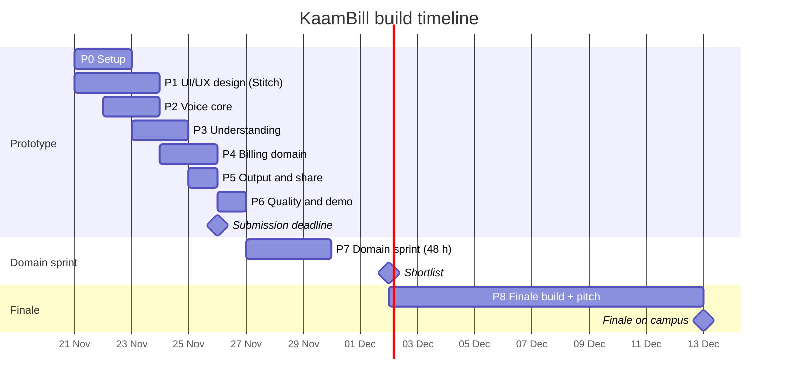
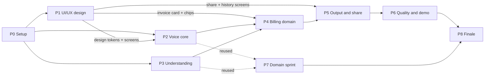

# KaamBill — Implementation Plan

> Related documents in this folder:
>
> - [`problemStatement.md`](./problemStatement.md): the problem, constraints, prototype scope and success metrics.
> - [`architecture.md`](./architecture.md): system design. Each phase below points to the sections it builds.
> - [`stitchPrompt.md`](../phase-1-ui-ux-design/stitchPrompt.md): Google Stitch prompts for every screen (used in Phase 1).
>
> **Current state (21 Nov, the 8:05 PM build):** tradesperson persona (electricians, plumbers, AC technicians); a kirana variant tried at 8:08 PM was reverted. Built and tested: the 5-step customer journey (items → check → payment details → payment → bill), mic with 4 s pauses, text box for Wispr Flow behind "Likh ke daalein", no text-to-speech, three app languages, Stitch-matched screens, 4-tab nav, phone-only layout, 208-sentence eval. Only `GROQ_API_KEY` is required. Left for you: deploy, real-phone and user tests, recordings, Hindi review, git setup. See [`architecture.md`](./architecture.md) (top table) for where each decision is described.

---

## 1. How This Plan Is Organised

Each phase has its **own folder** with a `README.md` covering the goal, dates, tasks, files to create, acceptance criteria and exit checklist.

| #   | Phase                            | Folder                                                  | Dates (2026) | Hackathon milestone                 |
| --- | -------------------------------- | ------------------------------------------------------- | ------------ | ----------------------------------- |
| 0   | Setup and foundations            | [`phase-0-setup/`](../phase-0-setup/)                   | 21–22 Nov    | Repo, contracts, seed data          |
| 1   | **UI/UX design (Google Stitch)** | [`phase-1-ui-ux-design/`](../phase-1-ui-ux-design/)     | 21–23 Nov    | —                                   |
| 2   | Voice core (reusable)            | [`phase-2-voice-core/`](../phase-2-voice-core/)         | 22–23 Nov    | —                                   |
| 3   | Understanding (LLM + normalizer) | [`phase-3-understanding/`](../phase-3-understanding/)   | 23–24 Nov    | —                                   |
| 4   | Billing domain                   | [`phase-4-billing-domain/`](../phase-4-billing-domain/) | 24–25 Nov    | —                                   |
| 5   | Output and share                 | [`phase-5-output-share/`](../phase-5-output-share/)     | 25 Nov       | —                                   |
| 6   | Quality, demo and evidence       | [`phase-6-quality-demo/`](../phase-6-quality-demo/)     | 26 Nov       | **Submission closes 26 Nov**        |
| 7   | Domain sprint                    | [`phase-7-domain-sprint/`](../phase-7-domain-sprint/)   | 27–29 Nov    | **Brief 27 Nov → submit 29 Nov**    |
| 8   | Finale                           | [`phase-8-finale/`](../phase-8-finale/)                 | 2–13 Dec     | Shortlist 2 Dec → **Finale 13 Dec** |



**Why build the core first?** The 27–29 Nov sprint gives everyone the same new brief and only about 48 hours. Phases 2 and 3 build the **reusable voice core** ([`architecture.md` §1.1](./architecture.md)), so on 27 Nov you only swap the extraction schema and the domain layer.

---

## 2. Phase Dependencies



Phases **1, 2 and 3 can run in parallel** with a team of 3: the designer owns Phase 1, and the two engineers own Phases 2 and 3. Phases 2 and 3 only share the `Turn` and `Extraction` types from Phase 0, and Phase 2 builds the UI shell against Phase 1's design tokens.

---

## 3. Phase-by-Phase Implementation

Each phase below lists: **goal**, **owner**, **inputs**, **step-by-step tasks**, **deliverables**, **acceptance criteria** and **exit gate**. The phase folder has the full checklist, code snippets and tests.

---

### Phase 0: Setup and Foundations

**📁 [`phase-0-setup/`](../phase-0-setup/) · 21–22 Nov · Owner: whole team · Status: 🟢 code done, 3 manual steps left (team lock, Vercel deploy + phone install, GitHub push)**

**Goal:** set up the repo, shared contracts and seed data so the design and engineering work can start in parallel.

**Inputs:** [`architecture.md` §4](./architecture.md), [`problemStatement.md` → Market Size](./problemStatement.md)

**Steps**

1. **Hackathon admin:** invite all teammates on the Scaler dashboard _before_ any submission (the team locks after the first one). Everyone installs Wispr Flow with their registered email. No Wispr API key is needed: Flow is used as a dictation app.
2. **Repo:** the phase-folder structure from §5 below:
   - Vite + React + TS + Tailwind + `vite-plugin-pwa` + XState + Vitest (app in `app/`)
   - Vercel `api/` entry files with `groq-sdk` and `zod` (v4, for `z.toJSONSchema`)
   - `phase-0-setup` as the `@kaambill/shared` workspace package
3. **Quality tooling:** ESLint (with an import-boundary rule) + Prettier + `lint-staged`; GitHub Actions running `typecheck → lint → test`.
4. **Deploy** an empty PWA to Vercel over HTTPS and install it on a real Android phone.
5. **Environment:** copy [`.env.example`](../.env.example) and [`.gitignore`](../.gitignore) into the repo; `.env` at the repo root for local dev (only `GROQ_API_KEY` is required); server secrets (`GROQ_API_KEY`, `ALLOWED_ORIGINS`, `RATE_LIMIT_PER_MIN`, …) only in Vercel environment variables; **never a key in `VITE_*`**; `phase-0-setup/server/env.ts` checks the variables at startup ([`architecture.md` §13](./architecture.md)).
6. **Shared contracts** in `phase-0-setup/src/types.ts`: `Turn`, `ExtractedItem` (with `qtySpoken` + `qty`, and `spokenUnitPrice` for prices the worker says), `Extraction` (every field present, `null` when unknown, for Groq strict mode; intents include `rate_update`), `RateCardEntry`, `Lang` ([`architecture.md` §4.1](./architecture.md)).
7. **Seed data:**
   - `rateCard.json`: 15 electrical and plumbing items with 2–4 aliases each
   - `eval/utterances.seed.jsonl`: 30 test sentences with the expected JSON (number words, misheard brands, missing name, unknown item, approvals and corrections)

**Deliverables:** repo + CI + live URL · `.env.example` + `.gitignore` + `phase-0-setup/server/env.ts` · `types.ts` · `rateCard.json` · `utterances.seed.jsonl` · repo README with "Built with Wispr Flow"

**Acceptance:** PWA installs on Android · CI green
**Exit gate:** ✅ team locked · ✅ contracts merged

---

### Phase 1: UI/UX Design (Google Stitch)

**📁 [`phase-1-ui-ux-design/`](../phase-1-ui-ux-design/) · 21–23 Nov · Owner: product/design · Status: 🟡 code parts done (theme + `tokens.ts` generated from Stitch, `flows.md`, `handoff.md`); Stitch fixes F1–F9 + usability test left (you)**

**Goal:** design every screen and state of the voice-first flow, fix the design system as code tokens, and check it with real users before engineers build the UI.

**Inputs:** [`stitchPrompt.md`](../phase-1-ui-ux-design/stitchPrompt.md) · Stitch export [`phase-1-ui-ux-design/design/`](../phase-1-ui-ux-design/design/) · design system [`DESIGN.md`](../phase-1-ui-ux-design/design/bharat_trades_kinetic/DESIGN.md) · [`architecture.md` §3, §7](./architecture.md)

**Steps**

1. ✅ **Stitch screens generated:** 16 screens + an illustration + the _Bharat Trades Kinetic_ design system. The inventory and mapping to the state machine are in [`architecture.md` §7.2](./architecture.md).
2. ⬜ **Apply sync fixes F1–F9** ([`stitchPrompt.md` §5](../phase-1-ui-ux-design/stitchPrompt.md)) and re-export. **F1 and F2 come first**, because the live bill screen skips the read-back and the read-back screen implies an automatic send. Then:
   - F3: remove the "Wispr AI / Wispr Live / Wispr Flow Active" labels from the voice dock; keep "Wispr Flow" only in the text-box placeholder
   - F4: remove "taxes included"
   - F5: remove "Bank linked ✓"
   - F6: canonical demo data, **₹1,235 / KB-2026-0042**
   - F7: Hinglish home
   - F8: remove site photos
   - F9: receipt header
3. ⬜ **Refine:** check contrast (WCAG AA) on the re-exported screens; keep the Devanagari home as the Hindi variant.
4. ⬜ **User flows** in `flows.md`:
   - happy path: Home → S2 → S3 → S5 → S6 → S7
   - clarification: S3 → S4 → S3 → S6
   - correction: S6 → "_nahi, 20 meter_" → S3 → S6
   - failure: S10a/b/c
5. ⬜ **Design tokens:** turn the `DESIGN.md` front matter into `phase-1-ui-ux-design/src/tokens.ts` + `tailwind.config.ts`. The colour roles are summarised in [`architecture.md` §7.5](./architecture.md). Use the Stitch `code.html` files as layout references for Phases 2, 4 and 5.
6. ⬜ **Component handoff** (`handoff.md`): the 4-tab bottom nav (Boliye · Bills · Rates · Khata; the Likh Ke tab was removed on 21 Nov, its text box now sits above the mic) plus every component with its states, and which phase builds it.
7. ⬜ **Usability test:** 3 people, 10 minutes each, using a clickable prototype. Tasks: make a bill, fix a quantity, send it. Log the results in `usability.md` and fix the top 3 issues.

**Deliverables:** re-exported Stitch folders (F1–F9 fixed) · `flows.md` · `handoff.md` · `usability.md` · `tokens.ts`

**Acceptance:** every screen follows [`architecture.md` §7.3](./architecture.md) (read-back before share, no automatic-send wording, no Wispr labels on the voice dock, no tax or bank claims) · canonical data on every screen · contrast checked · 3 tests done
**Exit gate:** ✅ F1–F9 fixed · ✅ tokens merged · ✅ handoff given to the Phase 2, 4 and 5 owners

---

### Phase 2: Voice Core (Reusable)

**📁 [`phase-2-voice-core/`](../phase-2-voice-core/) · 22–23 Nov · Owner: voice/integration engineer · Status: 🟢 built + tested (mic = browser speech with 4 s pauses + auto-restart; text box for typing / Wispr Flow; 3 app languages; no TTS; 4-tab nav) (12 machine tests, 6 STT tests, 4 Playwright e2e); real-phone mic test left (you)**

**Goal:** a domain-agnostic loop, **mic or text → transcript → state machine → on-screen reply**, that is reused unchanged for any new domain.

> **Voice in, screen out (21 Nov).** Speech-to-text is **required** (Wispr Flow into the text box, or the in-app mic with browser Web Speech in `hi-IN` / `en-IN`). Text-to-speech is **not built**: the app never speaks. See [`architecture.md` §5.1](./architecture.md).

**Inputs:** Phase 0 `Turn` type · Phase 1 tokens · screens **Home** (`kaambill_bol_ke_bill_banaiye`), **S2** (`kaambill_sun_raha_hoon_listening_state`), **S10a/c** (`kaambill_mic_blocked_fallback`, `kaambill_error_samajh_nahi_aaya`) · [`architecture.md` §3, §5.1, §5.6, §7](./architecture.md)

**Steps**

1. **Audio capture** (`core/audio/`): `getUserMedia` with noise suppression, echo cancellation and gain control; end of speech after **4 s** with no new words (browser restarts bridged; Stop button; Silero VAD dropped); emit `speechStart`, `speechEnd` and `level` for the waveform.
2. **Speech-to-text interface** (`core/stt/`): `SttProvider` (start/stop/onPartial/onFinal) plus `WebSpeechProvider` (`hi-IN`, interim results, continuous; no key). Stub `GroqWhisperProvider` and `SarvamProvider` for Phase 8.
3. **Text path** (`core/text/`): a `TextInput` that emits `Turn{source:"text"}` and skips speech-to-text. It autofocuses when the mic is blocked, so Wispr Flow users can dictate into it.
4. ~~TTS~~ **Removed (21 Nov):** no spoken output; replies are on-screen templates (≤ 2 sentences).
5. **State machine** (`core/machine/`): an XState machine `idle → listening → processing → clarifying | confirmingLowConf | readBack → awaitApproval → finalized → sharePreview`. Domain logic is injected through a `DomainAdapter` interface; approval words (_haan, bhej do, yes_) are recognised locally.
6. **App shell** (`ui/`), ported from the Stitch `code.html` files:
   - `TopBar`: brand, **language menu (Hinglish · हिंदी · English)**, Rate Card button. The menu switches screen text, mic language and app messages together (`phase-2-voice-core/src/ui/lang.tsx`: `UiLangContext`, `useT()` dictionaries per component)
   - `VoiceDock`: status label, 88px `MicButton` (green idle → blue pulsing while listening), `LiveTranscript`
   - `BottomNav`: 4 tabs, **Boliye · Bills · Rates · Khata** (no separate Likh Ke tab: the text box for typing / Wispr Flow is always above the mic on Boliye) ([`architecture.md` §7.1](./architecture.md))
   - `Canvas` slot
7. **Home** (Home screen): greeting, **today's earnings** (`TodaySummary`), the example sentence bubble, "Likh ke daalein" / "Kaise use karein", and a `RecentBills` placeholder (filled in Phase 5).
8. **Listening** (S2): live transcript, **Ruk jaiye (Stop)** and **Radd karein (Cancel)** actions; the tip "_Pura bill ek sath bol sakte hain_".
9. **Edge states:**
   - S10a: mic blocked → banner with "Theek karein" (opens permission help) and the text input opened
   - S10c: not understood → "Phir se" button, a **relative** noise-level indicator, and 3 tap-to-insert example phrases
10. **Import-boundary lint:** a phase never imports a later phase (so Phase 2 can't import Phase 4).
11. **Mobile-only layout:** every screen is built for a phone (360–430 px). On a tablet or monitor the app is a centred phone-width column (max 480 px) with the top bar and dock inside it; nothing is laid out for desktop widths.
12. **Two different inputs:** the **mic** = KaamBill listens (browser speech recognition, live transcript); the **text box above the mic** (hidden until "Likh ke daalein" is tapped; × closes it) = typing or dictating with **Wispr Flow** (keyboard / shortcut), with a short "how to start Flow" hint. A web page can't launch Wispr Flow (no URL scheme or API in Wispr's docs), so the mic never pretends to.

**Deliverables:** `capture.ts`, `vad.ts`, `SttProvider.ts`, `WebSpeechProvider.ts`, `TextInput.tsx`, `templates.ts`, `conversation.machine.ts`, `TopBar.tsx`, `VoiceDock.tsx`, `BottomNav.tsx`, `Home.tsx`, `ListeningView.tsx`, `banners/MicBlocked.tsx`, `banners/NotUnderstood.tsx`

**Acceptance:** with an **echo adapter**, voice and text loops both work on a real Android phone · Home, S2, S10a and S10c match their Stitch `screen.png` · machine unit tests green · lint boundary enforced
**Exit gate:** ✅ loop demo recorded 🎥

---

### Phase 3: Understanding (LLM Extraction + Normalizer)

**📁 [`phase-3-understanding/`](../phase-3-understanding/) · 23–24 Nov · Owner: understanding engineer (in parallel with Phase 2) · Status: 🟢 done: **99.0% field accuracy, p50 1.33 s** on Groq ([`phase-6-quality-demo/eval/results/phase3.md`](../phase-6-quality-demo/eval/results/phase3.md)); endpoint not yet deployed**

**Goal:** transcript → **validated `Extraction` JSON**, with Indian number words turned into exact values. For a new domain only the schema and prompt change.

**Inputs:** Phase 0 types + seed eval · [`architecture.md` §4.1, §5.2, §5.3](./architecture.md)

**Steps**

1. **Zod schema** `phase-0-setup/src/schema.ts`: one source of truth for the types and for the API's structured output.
2. **Endpoint** `phase-3-understanding/server/extract.ts`:
   - request `{turn, history(last 4), catalog(names+aliases), draftSummary}`
   - **Groq** `groq.chat.completions.create()` with `openai/gpt-oss-120b`, `reasoning_effort: "low"`, `include_reasoning: false`, `temperature: 0`, and `response_format = {type:"json_schema", json_schema:{name:"extraction", strict:true, schema: z.toJSONSchema(ExtractionSchema)}}`
   - strict-mode schema: every field required, optional fields nullable, `additionalProperties:false`; validate again with Zod
3. **Stable prompt:** keep the system prompt byte-for-byte fixed, with everything that changes in the user message; keep requests small to stay within Groq's free-tier per-minute limits.
4. **System prompt + 12–15 few-shot examples:** never invent prices; copy quantities exactly as spoken; Bill vs Estimate rules; intents (new job/add info/approve/correct/cancel/**history**, for S9 voice commands); optional discount.
5. **Config and protection:** model, effort and timeout read from env; origin allowlist, rate limit and input caps on `/api/extract` ([`architecture.md` §13.4](./architecture.md)).
6. **Error handling:**
   - `finish_reason === "length"` → return `intent: "unknown"` so the app asks the worker to repeat
   - catch the SDK's typed errors: 429 → retry once on `LLM_FALLBACK_MODEL` (`openai/gpt-oss-20b`); network or timeout → "_Network slow hai, ek baar phir boliye_"
   - remove phone numbers from logs
7. **Normalizer** `understanding/normalize.ts` (runs **on the phone**, turns `qtySpoken` into `qty`):
   - _sawa / dedh / dhai / paune / saadhe_, _sau / hazaar / lakh_, Hindi number words 1–100
   - unit aliases (m, pc, in, ft)
   - ambiguous result → lower that item's confidence
8. **Client** `understanding/client.ts`: 6 s timeout + 1 retry; approvals never reach the API.
9. **Run the seed eval** and record the results in `eval/results/phase3.md`.

**Deliverables:** `schema.ts`, `phase-3-understanding/server/extract.ts`, `extract.system.md`, `normalize.ts`, `client.ts`, eval results

**Acceptance:** ≥ 85% field accuracy on the 30 seed sentences · ≥ 40 normalizer tests passing · p50 < 1.5 s · strict-schema output on every call
**Exit gate:** ✅ endpoint deployed · ✅ key only on the server
_Model note: switch to `openai/gpt-oss-20b` (about twice as fast, half the price) only if Phase 6 shows the latency target is missed, and only after comparing on the eval set. That decision is yours._

---

### Phase 4: Billing Domain

**📁 [`phase-4-billing-domain/`](../phase-4-billing-domain/) · 24–25 Nov · Owner: voice/integration + understanding engineers · Status: 🟢 built: billing adapter + S3/S4/S5/S6/S8 screens; 61 domain tests + 4 Playwright e2e (demo ₹1,235 end to end)**

**Goal:** KaamBill's `DomainAdapter`: rate card, matcher, draft bill, one question at a time, amber chips and the on-screen read-back.

**Inputs:** Phase 2 `DomainAdapter` · Phase 3 `Extraction` · screens **S3** `kaambill_live_bill_assembling`, **S4** `kaambill_sawaal_clarifying_question`, **S5** `kaambill_low_confidence_confirmation`, **S6** `kaambill_read_back_aur_approval`, **S8** `kaambill_mera_rate_card`, **S10a/b** `kaambill_mic_blocked_fallback`, `kaambill_offline_queue_mode` · [`architecture.md` §3, §4.2–4.3, §5.4–5.5, §7](./architecture.md)

**Steps**

1. **Rate card** (S8): IndexedDB store, seeded; category tabs **Sab · Bijli · Plumbing · Mazdoori (Labour)**; search with a mic; edit price; "+ Item jodein"; voice edits (_"MCB ka rate 200 kar do"_); **learns** confirmed prices for new items and shows them with a **"Naya ✨"** tag.
2. **Matcher:**
   - exact match on name or alias
   - then `fuse.js` + a phonetic key (ph→f, v↔w, double letters collapsed, spelled letters → "mcb")
   - score below 0.6 = unmatched
   - brand-only mentions are flagged amber
3. **Bill model + `applyTurn()`:** additions, **corrections** ("_15 nahi 20_"), removals, optional **discount**; integer rupee totals; `KB-yyyy-seq` numbering; status `draft → queued (offline) → finalized`.
4. **Confidence** = `min(stt, extraction, match)`: above 0.85 normal · 0.6–0.85 **amber** · below 0.6 missing.
5. **Clarifier (one question only):** unknown price → no customer name → amber item → labour (only if the setting is on). Bill vs Estimate is never asked.
6. **Read-back:** "_{customer} ka total ₹{total} bana hai, {n} items ke saath. WhatsApp par bhej doon?_", shown on screen in the app language.
7. **Screens, ported from the Stitch HTML:**
   - **S3 Live bill:** `InvoiceCard` with customer header, `ItemChip` (normal / **amber "Check karein"** / **"Abhi joda gaya"** highlight / tap to edit), material and labour subtotals, `TotalRow`, **"+ Item jodein"**, **"Discount / Chhoot"**. The main button says "**Total dekhein aur bhejein →**" and leads to **S6, never straight to S7** (fix F1).
   - **S4 Question:** `QuestionBanner` with one question, **quick-reply price chips** ("₹25 per meter"), "Likh ke", and **"Baad mein tay karein" (Skip)**, which leaves the item marked "Pending".
   - **S5 Low-confidence confirmation:** the amber item focused, "_15 meter wire, sahi hai?_", **Haan, Sahi Hai** / **Badlein**.
   - **S6 Read-back:** item checklist, totals, `ReadBackPanel` with the read-back text, **Haan, bhejo** / **Badlav karein**. The wording says WhatsApp _will open_ (fix F2).
   - **S10a Text mode:** **quick-add chips** ("+ Finolex Wire", "+ Labour ₹500", "+ Visiting ₹200") that add items without speaking.
   - **S10b Offline:** if extraction can't reach the server, save the raw turn as a `queued` draft with the "Queue mein ⏳" tag, and process it automatically when the network comes back.

**Deliverables:** `rateCard/*` (incl. `RateCardScreen.tsx`), `match/matcher.ts`, `phonetic.ts`, `bill/model.ts`, `adapter.ts`, `clarify.ts`, `readBack.ts`, `offlineQueue.ts`, `ui/InvoiceCard/*`, `ui/QuestionBanner.tsx`, `ui/LowConfConfirm.tsx`, `ui/ReadBackPanel.tsx`, `ui/QuickAddChips.tsx`

**Acceptance:** the definition-of-done sentence (§8) gives **₹1,235**, directly or after one question · tap and voice edits recalculate the total · a price taught by voice is remembered · a queued offline draft is processed when the network returns · S3–S6, S8 and S10a/b match their `screen.png` (after fixes F1–F6)
**Exit gate:** ✅ Playwright end-to-end test (text path) green · ✅ Phases 2–3 still have no imports from Phase 4 (ESLint boundary rule)

---

### Phase 5: Output and Share

**📁 [`phase-5-output-share/`](../phase-5-output-share/) · 25 Nov · Owner: integration engineer + design · Status: 🟢 built: customer journey (payment details → payment → invoice, PAID/DUE), onboarding, UPI link + QR, A6 PDF (19.5 KB), share sheet / wa.me, history (paid via UPI/cash, voice commands), Khata, offline; 17 unit + 6 e2e tests; real UPI-app scan + 2-phone share left (you)**

**Goal:** after "_Haan_": **payment details → payment → invoice** (journey steps 3–5, [`architecture.md` §3.0](./architecture.md)), then the WhatsApp share sheet. **The worker taps Send.**

> **Customer journey (21 Nov):** 1 Items → 2 Check (questions + read-back) → **3 Payment details** (amount, payee UPI ID, customer number, UPI / Cash / Later) → **4 Payment** (QR scanned → worker taps "Paisa mil gaya ✓", or "Cash mila ✓"; KaamBill can't see payments, so paid = the worker's confirmation) → **5 Invoice** (PDF + WhatsApp, marked PAID or DUE). A step indicator shows where the bill is.

**Inputs:** Phase 4 finalized bill · screens **S1a–c** (`onboarding_1_aapka_naam`, `onboarding_2_upi_id_setup`, `onboarding_3_rate_card_setup`), **S7** `kaambill_share_preview`, **S9** `kaambill_bill_history`, **S11** `kaambill_printable_receipt_a6`, **Home** recent bills · [`architecture.md` §5.7, §7](./architecture.md)

**Steps**

1. **Onboarding, 3 steps** (S1a–c), with a progress bar, Hindi/EN switch and Skip:
   - **a. Name:** voice or text, trade chips (Electrician · Plumber · Mistri · AC Mechanic), preview "_Bill par yahi naam dikhai dega_"
   - **b. UPI ID:** text or voice ("_ramesh at the rate..._"), UPI app chooser (GPay/PhonePe/Paytm/BHIM), **format check only** (no "Bank linked" claim, fix F5), live "Payment to Ramesh Electricals" preview
   - **c. Rate card review:** the 15 seed items with "Badlein" / "Rate bole", and "+ Naya item"
   - The **Khata** tab reopens these settings later.
2. **UPI deep link:** `upi://pay?pa={vpa}&pn={workerName}&am={total}.00&cu=INR&tn=Bill {billNo}`; QR generated on the device (`qrcode`, error correction M).
3. **PDF** (`jspdf`, A6, S11 layout, "KACHHA BILL · Cash / UPI Memo"):
   - worker details, bill number, items, total, UPI QR
   - a Devanagari font
   - the "not a GST tax invoice" footer
   - under 200 KB
4. **Share preview** (S7): "Bill taiyaar hai!", the PDF preview with UPI QR, **WhatsApp par bhejein** (`navigator.share({files:[pdf]})`, falling back to `wa.me/{phone}?text=…`), **PDF download**, **Link copy**, the note "_Aap Send dabayenge tabhi bill jayega_", and a **Print** option on the receipt preview (S11). The completion line is spoken only _after_ the share sheet opens.
5. **History** (S9, **Bills** tab):
   - weekly summary: "_Is hafte ki kul kamai_", collected vs pending
   - filters **Sab · Baaki · Paid · Drafts**
   - `BillCard` with **Paid mark** (asks UPI or cash → `paid_via`), **Phir bhejein** (resend), **Receipt dekhein**, and "Poora karein" for drafts
   - **voice commands** "_Verma ji ka bill paid mark kar do_" and "_Kal ka Sharma ji wala bill bhejo_" (a new `history` intent in the Phase 3 schema)
6. **Home recent bills + today's earnings:** fill Phase 2's `RecentBills` / `TodaySummary` from history.

**Deliverables:** `profile/*` (`Onboarding.tsx` with 3 steps, `KhataScreen.tsx`), `output/upi.ts`, `qr.ts`, `pdf.ts`, `share.ts`, `ui/SharePreview.tsx`, `ui/ReceiptPreview.tsx`, `bill/history.ts`, `ui/History.tsx`, `ui/RecentBills.tsx`

**Acceptance:** the full flow works on a real phone in **under 25 s** · GPay/PhonePe/Paytm show the worker's name and **₹1,235** · PDF shares on 2 devices · works offline after finalizing · S1a–c, S7, S9 and S11 match their `screen.png` (after fixes F5, F6, F9)
**Exit gate:** ✅ nothing can be sent without the user tapping Send

---

### Phase 6: Quality, Demo and Evidence

**📁 [`phase-6-quality-demo/`](../phase-6-quality-demo/) · 26 Nov · Owner: whole team · 🚩 submission deadline · Status: 🟡 code parts done (208-sentence eval: 125 Hinglish · 43 Hindi · 40 English, resumable runner; telemetry, UI parity, Lighthouse 97/100/100, demo script); noise recordings, device tests, video and submission left (you)**

**Goal:** measure against the success metrics, fix the worst failures, record the demo and the Wispr Flow evidence, and submit.

**Steps**

1. **Grow the eval to ≥ 100 sentences**, recorded in real noise (fan, street, drill) with audio and expected JSON + total. Include **≥ 20 Wispr Flow-dictated text cases** to check that Flow's clean-up never changes a quantity or brand.
2. **`eval/score.ts`:** field accuracy, **total exact-match**, questions per bill, p50/p90 latency.
3. **Fix loop:** sort failures into speech-to-text / LLM / normalizer / matcher; fix with aliases, rules or few-shot examples; re-run; log in `eval/results/phase6.md`.
4. **UI parity check:** compare every built screen with its Stitch `screen.png` on a 360×800 phone (see the screen build map above); log the differences in `eval/results/ui-parity.md` and fix 🔴/🟠 items.
5. **Performance:** Lighthouse ≥ 80, app bundle under 500 KB, test on a 2 GB phone over throttled 3G; end of speech → read-back **< 3 s** at p50.
6. **Telemetry with no personal data:** `bill_finalized`, `bill_shared`, `bill_marked_paid`, `chip_corrected`.
7. **90-second demo video:** problem → speak → amber fix → read-back → share → QR scan → "Built with Wispr Flow" montage.
8. **Submit** with the measured numbers, the demo video and the Wispr Flow evidence.

**Acceptance:** > 90% field accuracy · read-back 100% correct · p50 < 3 s, or a documented gap and plan · no 🔴 UI-parity gaps · offline queue (S10b) tested in flight mode
**Exit gate:** ✅ submitted · ✅ demo video · ✅ Wispr Flow montage

---

### Phase 7: Domain Sprint (48 h)

**📁 [`phase-7-domain-sprint/`](../phase-7-domain-sprint/) · 27–29 Nov · Owner: whole team · Status: 🟡 prep done: generic extraction + handler, to-do rehearsal (3/3 on Groq), `npm run domain:new` scaffold, [`phase-7-domain-sprint/scaffold/PLAYBOOK.md`](../phase-7-domain-sprint/scaffold/PLAYBOOK.md); `domain-starter` branch waits for your git identity; sprint itself starts 27 Nov**

**Goal:** solve the **common sprint brief** by reusing Phases 2 and 3; build only a new schema, prompt, `DomainAdapter` and UI card.

**Before the sprint (by 26 Nov):** a 1-hour rehearsal (a "to-do list by voice" adapter) to prove the swap works · a `domain-starter` branch without the billing phases (4–5) · attend the Wispr master class.

| Hours  | Work                                                                                               |
| ------ | -------------------------------------------------------------------------------------------------- |
| H0–2   | Read the brief → `domain-<name>/problem.md` (user, the sentence they'd say, the output, why voice) |
| H2–4   | New Zod schema + 10 few-shot examples + clarification priority + reply templates                   |
| H4–12  | New `DomainAdapter` + UI card wired into the existing machine → rough end-to-end flow              |
| H12–16 | 30-sentence mini eval → fix the top failures                                                       |
| H16–24 | **Sleep / buffer**                                                                                 |
| H24–32 | Polish: one question at a time, read-back, amber chips, text path, offline                         |
| H32–40 | Demo video, README, diagram, Wispr Flow clips                                                      |
| H40–44 | Test on 2 phones                                                                                   |
| H44–48 | **Submit at least 4 h early**                                                                      |

**Team split:** voice/integration · understanding + eval · product/demo.
**Exit gate:** ✅ submitted by 29 Nov · shortlist on 2 Dec

---

### Phase 8: Finale (On Campus)

**📁 [`phase-8-finale/`](../phase-8-finale/) · 2–13 Dec · Owner: whole team · Status: 🟡 code parts done (Groq Whisper mic + `/api/stt`, Hinglish/Hindi/English replies, Devanagari Hindi numbers 1–100 + approvals, Whisper second pass, `?demo=1`, demo reset, warmup, pitch + Q&A, user-test kit); real users, native review, rehearsals, finale left (you)**

**Goal:** a strong live demo and pitch in front of Wispr leadership, founders and investors.

**Steps**

1. **Hindi and English polish (2–6 Dec):** test browser speech (`hi-IN`, `en-IN`) and Groq Whisper on 30 Devanagari-Hindi and 30 English eval sentences. **Only if both miss > 85%**, add `SarvamProvider`. Native-speaker review of the Hindi phrases. **No other languages.**
2. **Whisper second pass (optional, 4–7 Dec):** add `/api/stt` with **Groq Whisper** (`whisper-large-v3-turbo`, same `GROQ_API_KEY`); re-run clips below 0.85 confidence; keep it only if it measurably reduces amber chips and questions. Try self-hosted IndicWhisper only if Groq Whisper struggles with Hinglish.
3. **Robustness (5–9 Dec):** eval grown to **200+**; offline queue; tests for the risks (invented prices, noise, wrong approval words).
4. **Real users (3–10 Dec):** 5–10 tradespeople each make one real bill; record time, corrections and quotes (with consent).
5. **Demo hardening (9–12 Dec):** clip-on mic, text path (Wispr Flow) as a visible backup, a pre-recorded video, hotspot, 2 charged phones, endpoint warmed up beforehand.
6. **Pitch (10–13 Dec):** 3 minutes covering problem → live demo → evidence → market (7.3 cr → 1–1.5 cr) → how it makes money (freemium; GST mode and income exports as paid features) → built with Wispr Flow; plus a Q&A sheet.

**Exit gate:** ✅ Hindi + English ≥ 85% · ✅ 200+ eval · ✅ user evidence · ✅ pitch rehearsed ×3 → 🎤 **13 Dec**

---

### Screen → Phase Build Map (Stitch export ↔ plan)

Every screen in [`phase-1-ui-ux-design/design/`](../phase-1-ui-ux-design/design/) is assigned to exactly one build phase. A screen counts as **done** when the built page matches its `screen.png`, with the listed fixes from [`stitchPrompt.md` §5](../phase-1-ui-ux-design/stitchPrompt.md) applied.

| ID    | Stitch folder                            | Built in                                          | Key features from the screen                                                   | Fixes              |
| ----- | ---------------------------------------- | ------------------------------------------------- | ------------------------------------------------------------------------------ | ------------------ |
| —     | `bharat_trades_kinetic/DESIGN.md`        | **P1** → `tokens.ts`                              | Colours, type scale, radius, touch sizes                                       | —                  |
| Shell | (all screens)                            | **P2**                                            | Top bar, voice dock (text box + mic), 4-tab bottom nav                         | F3                 |
| Home  | `kaambill_bol_ke_bill_banaiye`           | **P2** (+ P5 recent bills)                        | Greeting, today's earnings, example bubble, recent bills                       | F7                 |
| S2    | `kaambill_sun_raha_hoon_listening_state` | **P2**                                            | Live transcript, Stop / Cancel, tip                                            | F3                 |
| S10c  | `kaambill_error_samajh_nahi_aaya`        | **P2**                                            | Retry, relative noise level, example phrases                                   | F3                 |
| S10a  | `kaambill_mic_blocked_fallback`          | **P2** (banner + text) · **P4** (quick-add chips) | Permission help, text mode, quick-add chips                                    | F3                 |
| S3    | `kaambill_live_bill_assembling`          | **P4**                                            | Item chips (amber / just added), subtotals, + Item, Discount                   | **F1**, F3, F4, F6 |
| S4    | `kaambill_sawaal_clarifying_question`    | **P4**                                            | One question, quick-reply prices, Skip → Pending                               | F3, F6             |
| S5    | `kaambill_low_confidence_confirmation`   | **P4**                                            | Focused amber item, Haan / Badlein                                             | F3, F6             |
| S6    | `kaambill_read_back_aur_approval`        | **P4**                                            | Checklist, read-back panel, Haan bhejo / Badlav                                | **F2**, F3, F6, F8 |
| S8    | `kaambill_mera_rate_card`                | **P4**                                            | Categories incl. Labour, voice search, "Naya" tag                              | F3                 |
| S10b  | `kaambill_offline_queue_mode`            | **P4** (queue) · **P6** (test)                    | Offline banner, "Queue mein" draft, auto-sync                                  | F3, F6             |
| S1a   | `onboarding_1_aapka_naam`                | **P5**                                            | Name by voice/text, trade chips, bill-name preview                             | —                  |
| S1b   | `onboarding_2_upi_id_setup`              | **P5**                                            | UPI ID, app chooser, payee preview                                             | **F5**             |
| S1c   | `onboarding_3_rate_card_setup`           | **P5**                                            | Seed rate card review, edit / speak a rate                                     | —                  |
| S7    | `kaambill_share_preview`                 | **P5**                                            | PDF + QR preview, WhatsApp / PDF / link, "you press Send"                      | F3, F6             |
| S9    | `kaambill_bill_history`                  | **P5**                                            | Weekly summary, filters, Paid (UPI/cash), resend, voice commands               | F3, F6             |
| S11   | `kaambill_printable_receipt_a6`          | **P5**                                            | A6 receipt, UPI QR, GST footer, print                                          | F6, **F9**         |
| —     | `worker_toolbox_illustration`            | **P2**                                            | Home empty-state image (imported straight from `phase-1-ui-ux-design/design/`) | —                  |

**Phase 6 check:** compare every built screen side by side with its `screen.png` on a 360×800 phone, and log the differences in `eval/results/ui-parity.md`.

### Phase Summary: Who Does What, When

| Date      | Product / Design                                  | Voice / Integration eng.                                                                        | Understanding eng.                              |
| --------- | ------------------------------------------------- | ----------------------------------------------------------------------------------------------- | ----------------------------------------------- |
| 21 Nov    | P0 admin · P1 ✅ Stitch screens, then fixes F1–F9 | P0 repo, CI, deploy                                                                             | P0 types, seed rate card, seed eval             |
| 22 Nov    | P1 flows, tokens                                  | P2 audio, VAD, speech-to-text, text path                                                        | P3 schema, endpoint                             |
| 23 Nov    | P1 usability test, handoff                        | P2 machine, UI shell                                                                            | P3 prompt, normalizer, seed eval                |
| 24 Nov    | P4 invoice card UI                                | P4 adapter, clarifier, read-back                                                                | P4 matcher, rate card learning                  |
| 25 Nov    | P5 share and history UI                           | P5 UPI, PDF, share                                                                              | P5 profile, history · start eval recordings     |
| 26 Nov    | P6 demo video, montage                            | P6 performance, device tests                                                                    | P6 eval ≥ 100, fix loop · domain-swap rehearsal |
| 27–29 Nov | P7 brief, templates, demo                         | P7 adapter + wiring                                                                             | P7 schema, prompt, eval                         |
| 2–13 Dec  | P8 users, pitch                                   | P8 Hindi + English polish (browser + Groq Whisper first, Sarvam only if needed), demo hardening | P8 Groq Whisper second pass, 200+ eval          |

_Solo builder: follow the same order. Combine Phases 2 and 3 over 22–24 Nov, and keep Phase 1 to the master prompt + S3/S6/S7 only._

---

## 4. Tech Stack

| Layer                         | Choice                                                                                                                                                                                                                                                                                                  | Why                                                                                                                                               |
| ----------------------------- | ------------------------------------------------------------------------------------------------------------------------------------------------------------------------------------------------------------------------------------------------------------------------------------------------------- | ------------------------------------------------------------------------------------------------------------------------------------------------- |
| Frontend                      | **Vite + React + TypeScript**, installable PWA via `vite-plugin-pwa`                                                                                                                                                                                                                                    | Fast to build, mobile-first, installable, works offline                                                                                           |
| State machine                 | **XState**                                                                                                                                                                                                                                                                                              | The conversation flow in [`architecture.md` §3](./architecture.md) maps directly onto it, and it's easy to test                                   |
| UI design                     | **Google Stitch** ([`stitchPrompt.md`](../phase-1-ui-ux-design/stitchPrompt.md)) → export in [`phase-1-ui-ux-design/design/`](../phase-1-ui-ux-design/design/) (`screen.png` + `code.html` per screen), design system `DESIGN.md`                                                                       | Fast, consistent mobile mockups that turn into code                                                                                               |
| Styling                       | Tailwind CSS with tokens from `DESIGN.md` ([`architecture.md` §7.5](./architecture.md))                                                                                                                                                                                                                 | The Stitch HTML already uses Tailwind, so layouts port over directly                                                                              |
| Speech-to-text (**required**) | Browser **Web Speech API** (`hi-IN` for Hinglish/Hindi, `en-IN` for English, no key) behind a swappable `SttProvider`; Groq Whisper as an optional second pass; Sarvam only if needed                                                                                                                   | Free, streams live ([`architecture.md` §5.1](./architecture.md))                                                                                  |
| Text-to-speech                | **None** (removed 21 Nov): questions and the read-back are on screen                                                                                                                                                                                                                                    | Wispr Flow covers voice input; speaking back was redundant                                                                                        |
| App language                  | Hinglish (default) · हिंदी · English, chosen in the top bar; per-component string dictionaries                                                                                                                                                                                                           | One choice drives screen text, mic language and app messages ([`architecture.md` §5.6](./architecture.md))                                        |
| Text input + Wispr Flow       | The **Likh Ke** text box; users dictate into it with the **Wispr Flow app** (no key, no code). Flow auto-detects the spoken language; it does **not** translate on phones (Command Mode translate is Mac/Windows only), and KaamBill doesn't need it to: the extraction understands all three languages | Hackathon fit; also a backup in noisy places ([`architecture.md` §5.1.1–5.1.2](./architecture.md))                                                |
| End of speech                 | Pause timer in `WebSpeechProvider` (Silero VAD dropped: size + mic contention)                                                                                                                                                                                                                          | Ends after **4 s** with no new words or on "Ruk jaiye"; restarts the browser recognizer when it stops by itself, so pauses between items are fine |
| Backend                       | Serverless functions (Vercel) in TypeScript: `/api/extract` (Phase 3), `/api/stt` (Phase 8)                                                                                                                                                                                                             | Stateless, keeps the API key off the phone; config in [`.env.example`](../.env.example)                                                           |
| LLM                           | **Groq** (`groq-sdk`), model `openai/gpt-oss-120b` (fallback `openai/gpt-oss-20b`), `reasoning_effort: low`                                                                                                                                                                                             | Very fast responses; **strict JSON schema** output; low cost and a free tier; see [Phase 3](../phase-3-understanding/)                            |
| Fuzzy match                   | `fuse.js` plus a custom phonetic key for Indian spellings                                                                                                                                                                                                                                               | Handles brand names like "Phenolex" and "M-C-B"                                                                                                   |
| Local storage                 | IndexedDB via `idb-keyval` / `dexie`                                                                                                                                                                                                                                                                    | Rate card and bills stay on the device ([`architecture.md` §4](./architecture.md))                                                                |
| Output                        | `qrcode`, `jspdf`, Web Share API, `wa.me` fallback                                                                                                                                                                                                                                                      | Everything generated on the device                                                                                                                |
| Tests                         | Vitest (unit), Playwright (end-to-end, mobile viewport)                                                                                                                                                                                                                                                 |                                                                                                                                                   |
| Build tooling                 | **Wispr Flow** for all dictation: prompts, code, docs                                                                                                                                                                                                                                                   | Hackathon requirement ([`architecture.md` §12](./architecture.md))                                                                                |

---

## 5. Repository Layout (code organised by phase)

The repo root is this folder (`r2/`). **Each phase folder holds its plan (`README.md`) and its code and tests.** `app/` wires the phases into one PWA and `api/` holds Vercel's entry points. ESLint enforces that **a phase may import earlier phases, never later ones**.

```
r2/
├── README.md · problemStatement.md · architecture.md · implementationPlan.md   (project-wide docs)
├── phase-0-setup/          tsconfig.base.json · eslint.rules.js · src/ (@kaambill/shared: types, Zod schema) · seed/rateCard.json · server/ (env, health) · scripts/ (check-env, test-phase) · testing/ (e2e helpers)
├── phase-1-ui-ux-design/   stitchPrompt.md · design/ (Stitch export) · src/ (theme.css, tokens, Icon) · flows.md · handoff.md
├── phase-2-voice-core/     src/ (machine, stt, text, voiceRuntime, ui shell) · e2e/
├── phase-3-understanding/  src/ (normalize, client, http) · server/ (structured, handler, rate-limit, extract-core, extract, prompts/)
├── phase-4-billing-domain/ src/ (match, rateCard, bill, clarify, i18n, speech, adapter, ui/) · e2e/
├── phase-5-output-share/   src/ (upi, qr, pdf, share, history, profile, ui/) · fonts/ · e2e/
├── phase-6-quality-demo/   vitest.config.ts · playwright.config.ts · src/ (telemetry) · eval/ (208 sentences, resumable runner, results/) · demo/
├── phase-7-domain-sprint/  src/rehearsal/ · server/ · scripts/ · scaffold/ (new.mjs, templates, PLAYBOOK)
├── phase-8-finale/         src/ (stt/GroqWhisperProvider, selectSttProvider, audio/vad, demo) · server/ (whisper, stt) · scripts/ · e2e/ · pitch.md · user-tests.md
├── app/                    index.html · vite.config.ts · src/ (main.tsx, App.tsx) · public/
├── api/                    health.ts · extract.ts · stt.ts · rehearsal/todo.ts (one-line re-exports)
├── domain-<name>/          created on 27 Nov by `npm run domain:new -- <name>`
└── package.json · package-lock.json · vercel.json · eslint.config.js · .env(.example)   ← only what npm / Vercel / ESLint require at the root

Each phase folder also has its own `package.json` (its runtime dependencies) and `tsconfig.json` (+ `tsconfig.server.json` if it has server code). The shared TypeScript base and ESLint rules live in `phase-0-setup/` (`tsconfig.base.json`, `eslint.rules.js`; the root `eslint.config.js` is a one-line re-export). The Vitest and Playwright configs live in `phase-6-quality-demo/`.
```

---

## 6. Accounts and Keys

| What                                     | Needed?                                                                 | Where it goes                                                      | Phase |
| ---------------------------------------- | ----------------------------------------------------------------------- | ------------------------------------------------------------------ | ----- |
| **Groq API key** (`GROQ_API_KEY`)        | ✅ **Required**, the only API key and the only line in the local `.env` | `.env` (repo root) + Vercel environment variables (server only)    | 0 / 3 |
| **Wispr Flow app** sign-in               | ✅ Required (everyone)                                                  | Install the app; sign in with your hackathon email. **No API key** | 0     |
| Vercel + GitHub accounts                 | ✅ Required                                                             | Hosting + CI                                                       | 0     |
| PostHog project key (`VITE_POSTHOG_KEY`) | Optional (public key)                                                   | `.env` / Vercel                                                    | 6     |
| Upstash Redis (rate limit)               | Optional                                                                | Vercel environment variables                                       | 3 / 6 |
| Sarvam key                               | Not used (no Sarvam code; removed from `.env`)                          | Only if the Hinglish/Hindi eval fails and the provider is built    | 8     |

Template: [`.env.example`](../.env.example) · details: [`architecture.md` §13](./architecture.md).

---

## 7. Working Rules (All Phases)

1. **Build by voice.** Dictate prompts, code and docs through **Wispr Flow**. Each phase lists a short clip to record as evidence ([`architecture.md` §12](./architecture.md)).
2. **Keep the phases layered.** A phase may import earlier phases, never later ones (ESLint enforces it; only `app/` wires everything). So the voice core (Phase 2) and understanding (Phase 3) never depend on billing (Phase 4). This is what makes a new domain a quick swap.
3. **Never auto-send.** Every path ends with the worker tapping **Send** in WhatsApp.
   3a. **No spoken output, mobile-only screens, three languages.** The app never speaks; every screen is a phone layout matching its Stitch design (`npm run ui:parity`); every visible string exists in Hinglish, हिंदी and English.
4. **Prices never come from the LLM.** They come from the rate card or from the worker.
5. **Follow each phase's exit checklist.** Don't start the next phase until the current one's checklist is complete, or deliberately cut items and log them in the phase README.

---

## 8. Definition of Done (Prototype)

The demo shows, on a real Android phone:

> Worker says _"Verma ji ke ghar 2 Havells MCB, 15 meter Finolex wire, aur 500 labour ka bill bana do"_
> → the bill fills in live → one amber chip is confirmed ("haan", tapped or said) → the screen shows the read-back _"Verma ji ka total ₹1,235 bana hai, 3 items ke saath. WhatsApp par bhej doon?"_ (canonical demo data: [`architecture.md` §7.4](./architecture.md)) → _"Haan"_ → the PDF and UPI QR open in the WhatsApp share sheet.

All of it in **under 25 seconds** ([`problemStatement.md` success metric #2](./problemStatement.md)).
