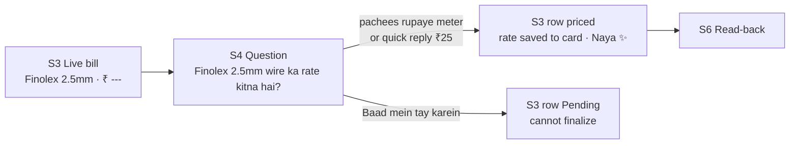
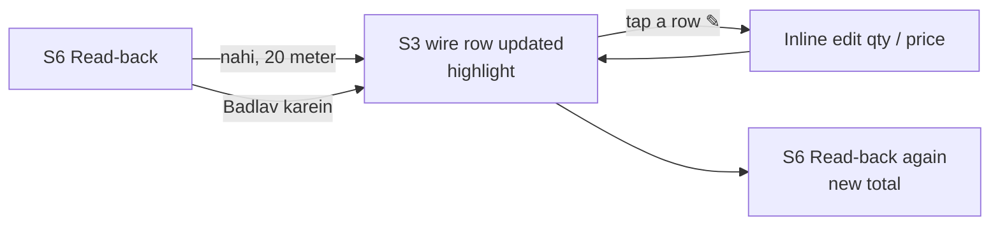

# User Flows

Screens = folders in [`../stitch_kaambill_voice_invoicing_app/`](./design/) (IDs from [`../architecture.md` §7.2](../docs/architecture.md)). States = [`../architecture.md` §3](../docs/architecture.md). Data = canonical demo (§7.4).

## 1. Happy path (the demo)

Never: S3 → S7 directly (fix **F1**). Never "bhej diya gaya" before the worker taps Send (fix **F2**).

## 2. Clarification path (unknown price)

Only **one** question on screen at a time. Priority: unknown price → customer name → amber item → labour (setting).

## 3. Correction path

## 4. Failure paths

| Trigger                           | Screen                                     | What the user sees                                                                                      | Recovery                            |
| --------------------------------- | ------------------------------------------ | ------------------------------------------------------------------------------------------------------- | ----------------------------------- |
| Mic permission denied             | **S10a** `kaambill_mic_blocked_fallback`   | "Mic band hai…", Theek karein help, text box open ("Likhein ya Wispr Flow se boliye…"), quick-add chips | Type / dictate with Wispr Flow → S3 |
| No network for `/api/extract`     | **S10b** `kaambill_offline_queue_mode`     | "Internet nahi hai — bill save ho gaya", draft tagged _Queue mein_                                      | Auto-processed when online → S3     |
| `intent: unknown` / garbled audio | **S10c** `kaambill_error_samajh_nahi_aaya` | "Samajh nahi aaya, ek baar phir boliye", noise level, 3 example phrases                                 | Phir se → S2, or tap an example     |

## 5. Other flows

- **First launch:** S1a name → S1b UPI ID (format check only) → S1c seed rate card → Home.
- **Bills tab:** S9 → Paid mark (UPI / cash) · Phir bhejein → S7 · voice: "_Verma ji ka bill paid mark kar do_".
- **Rates tab:** S8 → edit / speak a rate ("_MCB ka rate 200 kar do_", intent `rate_update`).
